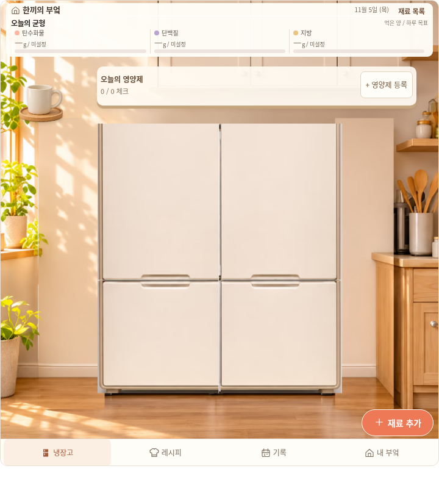
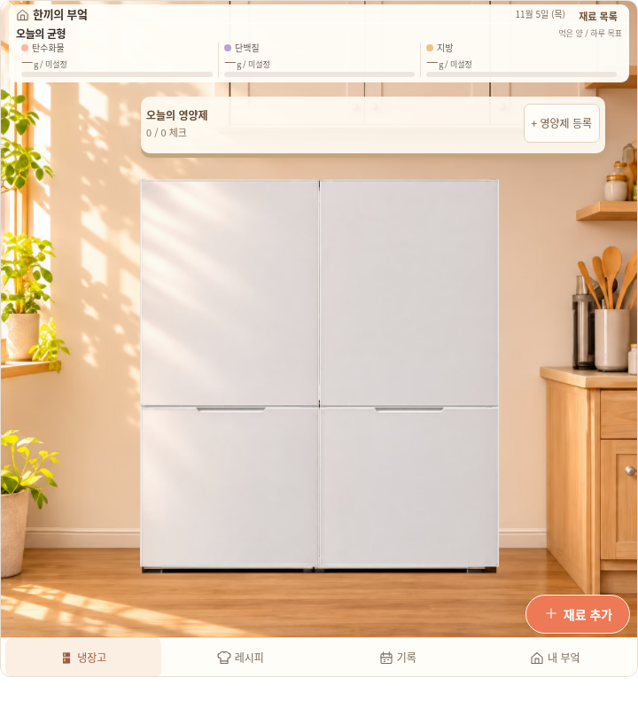

# 닫힌 냉장고의 비율과 배경 정합

사용자가 보낸 닫힌 냉장고 화면은 열린 본체와 다른 앞면 사진을 잘라 사용했다. 원본 구도와 생활 화면 기능을 유지하면서 `fix/kitchen-closed-registration-20261106`에서 `c6ed129d7e5559cf8bc5029ab0b2b91049445949`를 기준으로 수정한다. main 병합·운영 배포는 하지 않는다.

## 원인과 수정

- 이전 앞면은 다른 냉장고의 사진이었다. 실제 본체의 폭·상하 경계와 다른 비율을 `slice`로 잘라 윗부분까지 잃었다. 새 흰색 네 문을 같은 사진의 네 영역에서 추출하고, 네 면 모두 동일한 `448/572` 배율과 `meet`로 표시한다. 문 높이마다 가로·세로를 따로 늘리지 않는다.
- 열린 문을 숨기려고 붙인 직사각 배경이 다른 벽색으로 드러났다. 빈 부엌을 연속 배경으로 두고 원래 본체와 열린 문 실루엣만 그린다. 실제 설치 공간은 원래 `[278,352,699,776]`, 부엌 좌표는1254×1254로 유지한다. 상단 외측 경첩은 해당 문을 열었을 때만 보인다.
- 구형 SVG 배경색이 열린 문 실루엣 바깥을 흰 사각형으로 채웠다. 열린 문 SVG의 배경을 투명하게 하고, 하단 문 끝의 그림 영역과 기존 클릭 영역을 별도로 유지한다.
- 방 꾸미기의 조리대 좌표를 냉장고 사진에 재사용해 컵이 벽에 떠 있었다. 정상 냉장고 사진에서는 중복 소품 표시를 숨기고, 실제 소품·좌표·소유권은 보존한다. 방 꾸미기와 적용 후 방 화면에서는 기존 소품을 표시한다.

## 공유 파일의 이미지 검증

첫 압축 후보 `after-v1`은 폐기한 후보다. 원본 PNG 화면은 정상이었으나 기존 `kitchen-original-reveal-v1.avif`는 옛 문 지우기용 두 조각만 남긴 투명 이미지였다. 이를 전체 배경으로 사용한 실제 compact 화면에서 창문·수납장·바닥 대부분이 사라졌다. 기하·클릭 검사 통과를 시각 승인으로 취급하지 않았으며 실제 compact PNG를 확인해 배포 전에 발견했다.

기존 PNG·AVIF를 덮어쓰지 않고 전체 배경의 새 인코딩과 실제 사용 본체/문 영역의 새 인코딩을 별도로 만든다. 원본 해상도·픽셀 좌표·사용 영역을 유지하며 가려지는 미사용 영역만 압축 이미지에서 제외한다. 브라우저가 실제 디코딩한 전체 배경의 모든 픽셀이 불투명한지 검사해 조각 이미지를 다시 전체 배경으로 채택하지 못하게 한다.

## 확인 범위

실제 Chromium 전후 캡처, 저장 자료 보존, 네 문 클릭·새로고침·꾸미기 취소/적용·냉장고 복귀를 구분해 검사한다. 원본 HTML의 실제 저장과 opaque 공유 미리보기의 임시 저장은 다르다. 자동 기하 검사는 사용자 디자인 승인·실제 Notion·Safari·휴대폰 확인을 대신하지 않는다.

영양제·8개 비교 레시피·음식 그림일기 달력·식비·건강상식·꾸미기의 최신 요구는 [생활 화면 문서](KITCHEN_LIVING_2026-11-06.md)를 유지한다. 해당 문서의49사례와 식비2사례는 이전 `c6ed129d`의 검증 이력이며 이번 비율 수정에서 전부 다시 실행했다는 의미가 아니다.

## 최종 파일과 실행 증거

최종 후보는 `after-v2`다. [빌드 해시](kitchen-closed-20261106/build-manifest.json)의 소스103개·검증 소스3개와 생성4파일을 대조했다. 네 전달 파일은1,022,846–1,024,241B로 모두1MiB 이내이며, 검사를 마친 고정 파일을 그대로 `previews/`에 복사했다. [인코딩 품질·원본 보존](kitchen-closed-20261106/asset-quality.json)은 해상도1254²와 동일 사용 픽셀에서 WebP82보다 높은 PSNR/SSIM을 확인한다.

[검증 요약](kitchen-closed-20261106/verification.json)과 [전체 브라우저 결과 gzip](kitchen-closed-20261106/browser-results.json.gz)을 보존한다. 새 브라우저 검사14사례·7,031단언, Node233건, 전송12건, 문법 검사가 통과했다. 위젯은320×360·390×480·720×800·800×600의 native/opaque, 입력 자료2사례, 닫힌 기존v1 초기화4사례를 포함한다. 실제 문 클릭·재로딩·원문/수량/기한/좌표/식사/지출/영양제 보존과 꾸미기 취소/적용·복귀를 검사했다. 저장된104프레임에서 전체 배경1,572,516픽셀의 불투명도도 확인했다.

[전후 비교 출처](kitchen-closed-20261106/before-provenance.json)는 기존 before8동선·80PNG와 이번 기본8사례의 최초 자료가8/8 정확히 같음을 확인한다. 이전 캡처를 새 실행으로 계산하지 않는다. [실제 compact 수동 검토](kitchen-closed-20261106/manual-review.json)는720·320의 열림/닫힘/혼합6장을 직접 검토한 범위를 기록한다.

| 같은 자료·720×800 | 수정 전 | 수정 후 |
| --- | --- | --- |
| 실제 닫힘 캡처 |  |  |

[열린 화면](kitchen-closed-20261106/after-open-720.png), [부분닫힘](kitchen-closed-20261106/after-mixed-720.png), [320px 닫힘](kitchen-closed-20261106/after-closed-320.png), [320px 부분닫힘](kitchen-closed-20261106/after-mixed-320.png)도 최종 compact 파일의 실제 캡처다. 고정 QA 날짜는2026-11-05이며 기존 기본 자료와 명시적인 격리 QA 입력을 사용한다. 실제 사용자 자료를 시험하거나 예시를 제품 기본 기록으로 추가하지 않았다.

첫 실행의44개 배율 단언 실패는 실제0.00733CSSpx의 브라우저 배치 양자화였다. 최종 검사는 정확한 crop·균일 행렬·`meet`·설치 좌표를 유지하면서 실제 그림 오차1/64CSSpx 이내를 확인한다. [첫 실패 로그](kitchen-closed-20261106/rejected-first-results.json.gz), [compact 수용 거절](kitchen-closed-20261106/rejected-manual-review.json), [문제가 있던 실제 캡처](kitchen-closed-20261106/rejected-compact-720.png), [배경 검사 음성 대조](kitchen-closed-20261106/background-negative-control.json)를 보존했다. 오류를 성공으로 바꾸거나 실패 자료를 지우지 않았다.

[최종 보존 검사](kitchen-closed-20261106/preservation.json)에서 기준1322개 중1312개 파일이 동일하며, 허용된10개 기존 코드/문서/검토 HTML만 바뀌었다. 기존 사진·모델·저장 형식·금융 데이터·26개 Actions는 그대로다. 이번 변경을 main에 병합하거나 운영 사이트에 배포하지 않았다.

```bash
python scripts/test_kitchen_closed_browser.py --root /tmp/kitchen-frozen \
  --output /tmp/kitchen-closed-qa --browser-executable /usr/bin/chromium
```

별도 앱 기능 검사4사례·956단언은16가지 문 조합과 저장/재로딩을 통과했다. [앱 검사 원문](kitchen-closed-20261106/app-smoke-results.json.gz)은 앱 전체 시각 승인을 뜻하지 않는다. [기존 앱 전용 겹침](kitchen-closed-20261106/known-app-overlap.json)은720/1024의 큰 앱 영양 헤더와 영양제 선반이66px 겹치는 문제다. 기준 `c6ed129d`와 동일한 경계/해시로 재현됐으며 이번 위젯 비율 수정에서 앱 레이아웃까지 재설계하지 않았다. 공유하는 `mobile/widget.html`에는 이 앱 헤더를 사용하지 않는다.

실제 Notion·Safari·휴대폰과 공개 HTMLPreview 실행은 미검증이다. 이 환경은 HTMLPreview/GitHub API에403을 반환하므로 원본 공개 파일 HTTP 접근과 로컬 opaque 실행을 따로 보고한다. PR 생성도 기존 PR 조회가 가능할 때 진행하며, 조회 차단 상태에서 중복 여부를 추측해 생성하지 않는다. 전체 원시 실행 자료는 체크아웃 밖 `/workspace/.notion-cloud/kitchen-closed-20261106/`에 보존했다.
