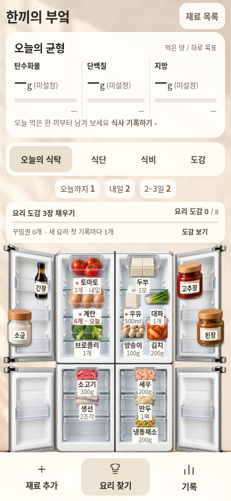
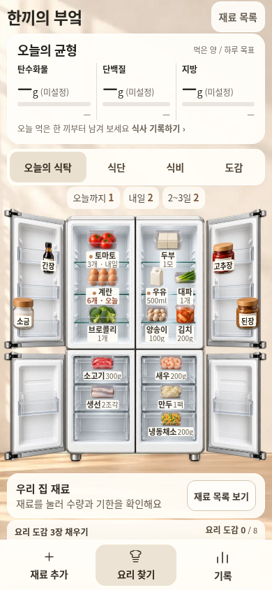

# 한끼의 부엌 · 재료와 세로 비례 조정

기준일: 2026-11-01 Asia/Seoul. 사용자가 열린 4도어 화면에서 재료가 너무 크고 전체 화면이 위아래로 길다고 지적했다. 이번 수정은 [기능과 사용 흐름 재구성](KITCHEN_COMPLETE_FLOW_2026-11-01.md)을 이어받아 그림의 비례·상단 여백·반응형 장면 기하만 조정한다.

## 현재 변경 범위

| 항목 | 적용 기준 |
| --- | --- |
| 유지할 외형 | 중앙의 코지한 흰색 4도어·따뜻한 배경·냉장/냉동 구획·독립 문 조작을 유지한다. 냉장고를 세로로 눌러 찌그러뜨리지 않는다. |
| 식재료 그림 | 냉장 그림 72%, 냉동 그림 85%, 문 안쪽 그림 72%의 배율을 적용한다. 이는 그림의 CSS 배율이며, 전체 장면 배율까지 합친 실제 화면 감소율은 별도 측정한다. |
| 읽기와 조작 | 재료 이름 라벨의 native 최소 11px를 유지한다. 그림 축소에 버튼 박스·히트 영역·라벨 글씨를 함께 축소하지 않고, 문 안쪽 이름 위치는 줄인 그림에 맞춘다. |
| 화질 | 기존 이미지 자산과 인코딩 해상도를 유지한다. 작은 그림을 만들기 위해 원본·전달 이미지의 화질을 낮추거나 새 자산을 생성하지 않는다. |
| 상단 정보 | 탄단지 현재량(목표량), 임박 요약과 바로가기의 의미를 유지하며 HUD·카드의 padding·행 간격·불필요한 세로 여백을 압축한다. |
| 도감 진행 | `kitchenMilestone`을 냉장고 위에서 빼고 냉장고 아래, ‘오늘의 식탁’ 앞에 둔다. 도감·목표·보상 기능 자체는 유지한다. |
| 장면 기하 | 냉장고 화면의 논리 높이는 1000, 다른 공간은 1200을 쓴다. 넓은 화면은 room 최대 520px와 viewport 가용 높이를 함께 고려하고 최소 fit 크기 380px를 둔다. |
| 가운데와 비율 | 실제 표시 폭에 맞는 배율·중앙 offset·배경 바닥을 계산하며 본체의 물리적 종횡비를 유지한다. 짧은 뷰포트에서 최소 크기 때문에 필요한 스크롤과 가로 넘침을 구분한다. |
| 레이아웃 갱신 | 상단 HUD와 도감의 크기 변화를 observer로 확인해 장면과 라벨 배치를 갱신한다. 카메라 전환·resize 후에도 같은 계산을 적용한다. |
| 드래그 미리보기 | ghost 그림은 실제 원본 그림의 `getBoundingClientRect()`를 기준으로 맞춘다. 줄인 그림을 끌 때 복제본만 커지거나 포인터에서 벗어나지 않는지 검사한다. |

모델·워크플로·OCR·예산·식사/도감 기록의 계산 내용과 원래 운영 소스는 이번 비례 수정의 변경 대상이 아니다. 시안 저장 키 `miniature-kitchen-preview-v1`, envelope version 1, 저장된 이름·수량·기한·좌표·층·문 상태를 유지하며 화면 크기를 이유로 다시 쓰지 않는다. 이전 기능 재구성에서 남긴 전체 사진 객체 인식·새 미니어처 생성·공식 성분/가격 데이터·개인화·운영 연결 범위도 그대로다.

## 전후 비교와 최종 검증

비교는 앱·위젯 각각 **320 / 390 / 649 / 1120px의 8개 프로필**에서 진행한다. 동일한 원본 v1 envelope·날짜·문 상태·선택 상태를 복원하며, 식재료를 새 위치로 옮겨 작은 그림처럼 보이게 만들지 않는다. 초기 viewport와 전체 페이지, 벽/바닥·선반/라벨·버튼·드래그 상태를 따로 확인한다.

아래 결과는 이번 고정 생성 파일에서 확인했다. 이전 기능 수정의 검사 수치를 재사용하지 않았다.

| 확인 항목 | 실제 결과·근거 |
| --- | --- |
| 기준/생성물 | 기준 `c248a4ab`. 앱1,011,490B / 위젯1,011,493B, wrapper1,036,324B / 1,036,333B. [크기·SHA256](kitchen-proportions/generated-files.json). 모두 검사한 바이트와 일치하며 이미지8개 인코딩 바이트도 이전과 같다. |
| 실제 크기 | 모바일 냉장/양념 그림 폭28% 감소. 넓은 화면은 장면 확대도 제한해 약41~50% 감소. 냉동은15~40.9% 감소. 이름11px·수량10px 최소 유지. [8개 실제 비교](kitchen-proportions/comparison.json). |
| 세로 길이 | 앱320:3460→3205px(-7.4%),390:3316→3062px(-7.7%),649:3394→2942px(-13.3%),1120:3073→2539px(-17.4%). 390 이상 초기 냉장고의 dock 가림0,320은28.5%→0.97%. |
| 같은 상태 | 앱/위젯8개 원본 envelope exact, 문4개 열림/선택없음/동일 날짜. JS예외0, 가로 넘침0. 냉동 라벨은 글자 크기를 유지한 이름+수량 한 줄이며 그림/이름ID·수량·2px간격이 맞는다. |
| 문·드래그·resize | 추가 실제 조작10개 프로필 통과: 8개 화면의 문4개 독립 열기/닫기, 냉장/냉동/문 양념 ghost 크기/이동량, 도킹 drop 취소, 그림 겹침과 reload exact. opaque320/390 하단3버튼 실제터치도 통과. [조작 근거](kitchen-proportions/interaction-results.json). 반응형559/560/999/1000 경계4개도 통과했다. [경계 근거](kitchen-proportions/boundaries.json). 문 비율0.57345와 장면 중앙 오차0px를 유지하며 경계의 폭 차이는3.57%/1.53%다. |
| 기능·저장 회귀 | 기존 사용 흐름22+가독성23+기본 기능27 = **72/72 통과**, JS0. 원래8개 envelope와 운영 키·수량·기한·좌표·층 보존. [요약](kitchen-proportions/final-summary.json) · [기록/분량](kitchen-proportions/journey-results.json) · [가독성](kitchen-proportions/readability-results.json) · [기존 기능](kitchen-proportions/regression-results.json). |
| 공개 HTTPS | **6/6 통과**. 앱·위젯 × 649×900/390×844/320×660, HTTP200·원문SHA256 일치·JS예외0. 문·실제터치·영양/예산/사진 검수 흐름과 정상 CDN OCR2개도 통과했다. [결과](kitchen-proportions/public-results.json), [실행](https://github.com/Ohoredingdong/Notion/actions/runs/41301550470). 물리 기기/Safari/실제 Notion은 미검증이다. |

### 같은 원본 데이터의 전후 화면

| 390px 전 | 390px 후 |
| --- | --- |
|  |  |

[PC 전](kitchen-proportions/app-1120-before.png) · [후](kitchen-proportions/app-1120-after.png) · [320px 전](kitchen-proportions/app-320-before.png) · [후](kitchen-proportions/app-320-after.png) · [649px 전](kitchen-proportions/app-649-before.png) · [후](kitchen-proportions/app-649-after.png) · [위젯 전](kitchen-proportions/widget-390-before.png) · [후](kitchen-proportions/widget-390-after.png)

공개 미리보기의 임시 저장 성격을 바꾸거나 main/운영 배포를 완료한 것으로 보고하지 않는다.

## 공개 확인과 반영 상태

고정 소스: `268e4d7eeb64e01473f7c38ed25f15d08d6ebaa1`. 후속 증거/문서 커밋은 생성 HTML을 바꾸지 않는다.

- [앱 열기](https://htmlpreview.github.io/?https://raw.githubusercontent.com/Ohoredingdong/Notion/268e4d7eeb64e01473f7c38ed25f15d08d6ebaa1/previews/mobile/app.html)
- [위젯 열기](https://htmlpreview.github.io/?https://raw.githubusercontent.com/Ohoredingdong/Notion/268e4d7eeb64e01473f7c38ed25f15d08d6ebaa1/previews/mobile/widget.html)
- [냉장고 부분 실제 화면](kitchen-proportions/app-390-fridge.png)

`fix/kitchen-compact-proportions`에 push했다. base `feat/kitchen-complete-flow`로 PR 생성을 시도했으나 GitHub GraphQL API403 Forbidden으로 생성되지 않았다. [PR 비교/작성 화면](https://github.com/Ohoredingdong/Notion/compare/feat/kitchen-complete-flow...fix/kitchen-compact-proportions?expand=1).

공개 검증은 `delivery/verify-kitchen-proportions-20261101`, 합성 결과는 `preview/kitchen-proportions-validation-20261101`에서만 실행/게시했다. main/Pages 설정/운영 진입점/사용자 데이터에는 반영하지 않았다.
