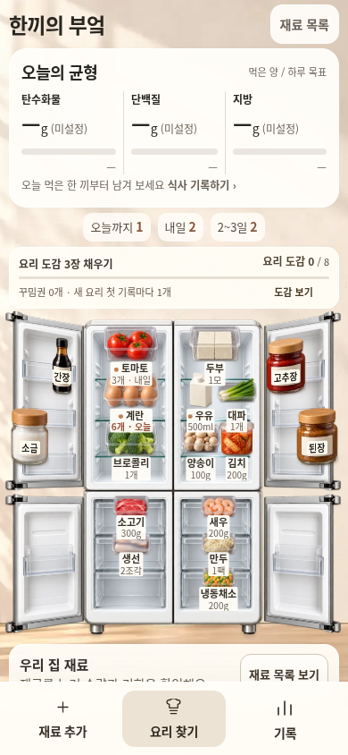
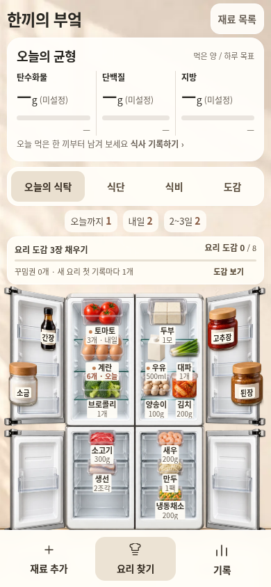

# 한끼의 부엌 · 기능과 사용 흐름 재구성

기준일: 2026-11-01 Asia/Seoul. 작업 브랜치: `feat/kitchen-complete-flow`. 직전 가독성 수정과 공개 검증은 [이전 기록](KITCHEN_READABILITY_REDESIGN_2026-11-01.md)에 보존한다.

사용자가 “기준이뭐야?? 필요한 기능들이 다 안들어간거같은데”라고 지적하고 “다시해봐바”라고 요청했다. 앞선 메뉴 개수와 가독성·조작 회귀 통과는 전체 기획의 완료 기준이 아니었다. 사진 자동화의 부재, 이름만 맞추던 추천, 식단 3회분이 기록·장보기에서 1회분으로 돌아가는 연결 오류를 분리해 확인했다.

이번 기준은 **재료 등록·기한 관리 → 재고와 입력한 영양·예산을 고려한 요리 선택 → 계획한 분량의 식사 기록·재고 반영 → 월간 확인·도감과 꾸미기**가 실제 조작으로 이어지는지다. 아래는 현재 소스의 변경 범위이며, 최종 실행 통과와 남은 자동화를 같은 의미로 취급하지 않는다.

## 화면과 기능의 연결

선택한 04 열린 냉장고, 흰색 4도어, 따뜻한 아이보리·린넨·우드, 탄단지 현재량(목표량)을 이어간다. 앱·위젯은 같은 공통 소스에서 생성한다. 기능을 드러내기 위해 냉장고와 글씨를 일괄 축소하거나 모든 기능을 하나의 숨겨진 ‘기록’ 메뉴로 돌리지 않는다.

| 항목 | 이번 소스의 변경과 판단 범위 |
| --- | --- |
| 오늘의 식탁 | `home.js`가 실제 기록으로 추천 요리·식단·남은 식비·영양제·월간·도감/목표·사진 등록을 보여준다. 명시적인 바로가기와 각 요약의 행동으로 진입한다. 없는 기록을 예시 섭취·지출로 채우지 않는다. |
| 같은 추천 근거 | 홈과 오른쪽 LCD는 `KitchenHome.recommendation()`의 같은 후보를 쓴다. 기존 조리대의 초기 ‘계란 볶음밥’을 자동 추천처럼 고정 표시하던 경로를 바꾼다. 입력된 1회분 열량·원가도 LCD에 연결한다. |
| 수량을 보는 추천 | `journey-model.js`는 기한이 지난/소진된 묶음을 제외하고 여러 묶음의 호환 수량을 배분한다. 이름만 존재하는 상태를 ‘준비 가능’으로 표시하지 않는다. 수량·단위·기한이 불명확하면 확인 상태로 남긴다. |
| 추천의 영양·예산 | 기존 8종 catalog 안에서 임박 재료·수량 충족·입력된 원가와 남은 월 예산·입력한 오늘 영양/목표를 근거로 정렬하고 이유를 표시한다. 외부 레시피/가격/성분을 자동 확보하거나 건강 점수를 산출하는 기능은 아니다. |
| 식단의 날짜·분량 | 계획 ID·날짜·분량을 기록 폼으로 전달한다. 3회분 계획은 3회분으로 시작하며, 입력된 1회분 영양·원가는 분량에 맞춰 계산한다. 실제 먹은 양은 확정 전에 바꿀 수 있다. 한 계획은 한 확정 식사와 연결하며, 실제 분량을 줄여 기록할 때 남길 계획은 별도로 추가한다. |
| 필요한 장보기 수량 | 분수·같은 단위와 명시적 호환 단위를 스케일한다. 여러 미기록 식단의 수요를 합친 뒤 같은 재고를 한 번 배분한다. ‘조금’ 등 미상 분량, 개/모와 g 같은 다른 차원의 단위는 임의 변환하지 않는다. |
| 식사 확정·수정·취소 | 확인한 실제 사용량을 식사와 함께 반영한다. 연결된 계획은 완료를 표시하고 중복 기록을 막는다. 수정·취소·복구는 재고와 계획 완료 상태를 함께 다룬다. 계획만 추가하거나 장보기로 옮기는 행동은 식사·재고 소비가 아니다. |
| 식비의 의미 | 레시피 사용 원가는 예상/입력 정보다. 실제 지출은 장보기 구매 확정이나 지출 입력에서 기록하며, 식사 기록 때 다시 차감하지 않는다. 같은 계획의 장보기 갱신도 기존 구매 기록을 임의로 지우지 않는다. |
| 영양제와 월간 | 영양제 일정·날짜 체크와 실제 식사/지출의 월간 요약을 홈에 연결한다. 영양제의 성분명 메모나 체크를 실제 함량·식사 영양값으로 자동 합산하지 않는다. |
| 도감·목표·보상 | 목표 선택 → 새 요리 식사 기록 → 도감/꾸밈권 → 소품 선택·배치로 가는 기본 UI 경로를 노출한다. 기존 8종 도감·목표/보상 규칙을 쓰며, 새로운 캐릭터나 건강 점수·섭취량 경쟁 보상을 만들지 않는다. |

하루 탄단지의 퍼센트는 **기록한 g ÷ 직접 정한 목표 g**다. 월간 탄단지 비율은 세 값을 모두 입력한 식사의 **4/4/9 에너지 비율**이다. 미입력을 0으로 취급하지 않고, 집계에 빠진 식사가 있으면 표시한다. 공식 권장량이나 전체 실제 섭취를 파악한 건강 판정으로 설명하지 않는다.

## 제품·기한 사진 두 장의 기기 내 글자 인식

`photo-reader.js`는 사용자가 선택한 제품 원본과 기한 원본에서 Tesseract.js로 한국어·영어 글자를 읽는다. 이름·내용량·날짜는 후보이며 다음 순서를 따른다.

1. 원본 사진 두 장을 각각 선택한다. 두 장이 준비되기 전에는 읽기 버튼을 활성화하지 않는다.
2. 기기 안에서 원본을 읽고 진행·실패·취소 상태를 보여준다. 처음에는 Tesseract 5.1.1, WASM/core와 고정된 한국어·영어 자료를 다운로드하므로 인터넷 연결이 필요하다.
3. 원문과 이름·수량·기한 후보를 비교한다. 제조일과 기한을 구분하고, 여러 날짜나 읽지 못한 값은 직접 확인한다.
4. 사용자가 원본 확인 체크를 한 뒤 재료 입력 폼으로 이동한다. **검수 확인만으로는 재고를 저장하지 않는다.** 마지막 재료 저장에서 보관 위치·수량·기한·그림을 확정한다.

읽기는 원본 File을 사용하고, 저장되는 사진은 별도로 축소한 thumbnail이다. 원본은 작업 중 메모리에만 두고 읽기 완료·취소/화면 이탈 시 해제한다. 사진을 HTTP로 전송하는 OCR 서버·인증키를 사용하지 않는다. 외부 요청은 인식 도구와 언어 자료를 받기 위한 것이며, 원격 검증에서는 정상 CDN 요청과 사진 POST 부재를 확인해야 한다. 라이브러리 다운로드 실패나 읽기 실패는 직접 입력 경로로 이어진다.

이 기능은 사진의 **글자**를 읽는다. 냉장고 전체 사진 속 음식의 객체 분류, 가려진 재료 추측, 제품 사진으로 새 미니어처를 생성하는 기능을 포함하지 않는다. 전체 사진 경로는 아직 사진을 보며 후보를 직접 입력하는 방식이고, 재료 이미지는 제품 사진 또는 기존 미니어처를 선택한다.

## 데이터와 운영 경계

- 원래 운영 진입점 `use-me-first.html`·`use-me-first-widget.html`, 운영 저장 키와 GitHub Pages/Notion 주소를 보존한다. 이번 시안 기록을 운영 데이터에 자동 병합하지 않는다.
- 시안 키 `miniature-kitchen-preview-v1`, envelope version 1과 기존 world/play/workflow를 유지한다. 저장된 재료 이름·수량·날짜·좌표·층·문 상태를 디자인 변경을 이유로 다시 쓰지 않는다.
- 계획 연결에는 기존 transaction 항목의 **선택적 `planId`·`portions`**를 덧붙인다. 필드가 없는 이전 transaction/백업도 읽고, 기존 미지 필드도 보존해야 한다. 최종 호환·복구 검증은 아래 실행 증거에 기록한다.
- 공개 HTMLPreview wrapper는 `allow-scripts allow-forms`의 opaque 프레임을 유지한다. 공개 링크는 임시 세션이고 보관 안내와 백업/복구 진입을 노출한다. 일반 브라우저 출처에서의 기존 시안 저장과 구분한다.
- 동기화·계정 연결·기존 앱 기록 연결·정식 지속 호스팅은 이번 공개 검토 링크만으로 완료되지 않는다. main 변경/병합·Pages 설정 변경은 별도다.

## 남아 있는 요구사항

| 요구 | 현재 경계·다음 완료 조건 |
| --- | --- |
| 냉장고 전체 사진 자동 재료 분류 | 수동 후보 입력만 있다. 실제 객체 인식과 후보별 수정·확정, 누락·오인식 처리를 검증해야 한다. |
| 제품 사진 기반 새 미니어처 생성 | 제품 사진/기존 그림 선택만 있다. 생성 제공자·실제 생성 결과·실패/원본 보존이 필요하다. |
| 공식 식품 성분·가격 데이터 | 8종 요리의 확인된 영양·원가를 직접 입력한다. 출처·단위·기준량·수집일이 있는 데이터 연결이 필요하다. |
| 개인 권장량·식사 건강정보 | 직접 정한 목표와 입력 값의 집계다. 공식 근거와 개인화 입력/산식, 정보의 적용 범위가 필요하다. |
| 일상 사용의 지속 저장·동기화·운영 연결 | 공개 미리보기는 임시다. 안정적인 출처와 원본 보존·충돌/복구가 검증된 저장/운영 연결이 필요하다. |
| 더 넓은 레시피·꾸미기 성장 | 현재 8종/기본 목표·보상의 범위를 유지한다. 다양한 요리·선택 가능한 성장 콘텐츠는 별도 확장이다. |

## 생성 환경

compact 생성은 기존 이미지 원본과 직전 compact 해상도 설정을 보존하면서 **Terser 5.44.1로 JavaScript를 축소**한다. 기능이 늘었다는 이유로 사진 해상도나 기능 코드를 추가 삭제하지 않는다. 이 저장소의 루트에 npm 의존성이나 package lock을 추가하지 않는다.

기존 클라우드 환경은 `source /workspace/.notion-cloud/activate.sh`가 외부 도구를 선택한다. 별도 환경의 준비 예시는 다음과 같다. compact 이미지 인코딩에는 기존대로 `magick`도 필요하다.

```bash
npm install --prefix /tmp/notion-kitchen-build-tools --no-save --package-lock=false terser@5.44.1
export KITCHEN_TERSER=/tmp/notion-kitchen-build-tools/node_modules/.bin/terser
"$KITCHEN_TERSER" --version
python scripts/build_miniature_kitchen_preview.py --compact
python scripts/build_kitchen_mobile_preview.py
```

`KITCHEN_TERSER`가 없으면 PATH의 terser를 찾으며, 사용할 수 없으면 명확한 오류로 중단한다. 원본 `scene.html`·JS/CSS와 검토용 생성 HTML을 구분하고, 검증한 생성 파일의 hash와 게시한 고정 소스 hash를 연결한다.

## 최종 실행·화면 검증

아래는 이번 고정 생성물의 실행 결과다. 이전 작업의 통과 수치를 재사용하지 않았다. 실제 CDN OCR 실행과 전체 사진 객체 인식, 실제 휴대폰·Safari·Notion 검증을 구분한다.

| 항목 | 실제 결과·증거 |
| --- | --- |
| 생성 파일 | 앱 1,006,671B / 위젯 1,006,674B. 공개 wrapper 1,031,386B / 1,031,395B로 각각 1MiB 이내. [크기·SHA256](kitchen-complete-flow/generated-files.json). 검사한 파일을 그대로 복사했다. |
| Node·Python | **219/219**, **264/264** 통과. 새 순수 수량/추천 33개, OCR parser/취소 9개, wrapper 정확한 원문 복원 2개 포함. |
| 실제 UI 여정 | 신규 **22/22**, 기존 가독성 **23/23**, 기존 흐름 **27/27**, JS 예외 0. [새 여정](kitchen-complete-flow/journey-results.json) · [가독성](kitchen-complete-flow/readability-results.json) · [기존 흐름](kitchen-complete-flow/regression-results.json). |
| 분량·날짜·차감 | 실제 폼으로 3회분 계획→234kcal/탄30·단15·지6/입력 원가3000원·5재료의 3배 사용량을 확인. 중복 기록 방지·취소 exact 복구·재차감, 계획 삭제 후 기존 식사 수정도 통과. |
| 장보기 | 2+3회분 수요 합산 후 보유 재고를 한 번만 배분. 재실행 중복 추가 없음. 기한/양을 확인해야 하는 재고에 확정 구매량을 만들지 않는다. |
| 홈·LCD | 실제 입력 후 추천 ID·부족 수량/수량 충족 상태·0kcal/0원 및 미입력 구분 일치. 예산·영양제·월간 요약 갱신, 320/390/1120px과 opaque touch 확인. |
| 목표·도감·보상 | 모델 상태를 미리 심지 않고 실제 UI로 목표→식사 기록→꾸밈권→타일 선택/장착 여정 통과. [기록 화면](kitchen-complete-flow/goal-meal-reward-earned.png). |
| 실제 OCR 엔진 | 동일 엔진 바이트의 로컬 미러에서 native/opaque 둘 다 한국어 ‘신선한 우유’·500mL·2026-11-30 인식, 예외 0. [별도 로컬 근거](kitchen-complete-flow/local-ocr-engine.json). 이 환경의 원본 CDN 브라우저 CA 오류와 별도로, 아래 공개 CI에서 정상 CDN의 실제 엔진·검수 UI를 앱/위젯 모두 확인했다. |
| 저장·구버전 | 실제 편집·reload·구버전 필드 없는 거래 기록·미지 envelope 필드·운영 키·날짜·좌표 보존 통과. 공개 wrapper는 계속 opaque 임시 세션이다. |
| 같은 상태의 전후 화면 | 앱·위젯 320×660 / 390×844 / 1120×1000. 고정 날짜, 초기 envelope, 문 네 개 열림, 선택 없음이 정확히 같다. [비교 결과](kitchen-complete-flow/comparison.json). 냉장고 폭을 줄이지 않았다. |
| 공개 HTTPS·원본 CDN OCR | **6/6 통과**, 정상 CDN 실제 OCR **2/2 통과**. 앱·위젯 × 649×900 / 390×844 / 320×660, HTTP200·원문SHA256 일치·JS예외0. 두 phone 프로필에서 한국어 제품명·500mL·2026-11-30을 실제 읽고 검수→최종 입력 폼까지 확인. 사진 HTTP POST/동기화 요청 없음, 최종 저장 전 재고 불변. [공개 결과](kitchen-complete-flow/public-results.json), [실행](https://github.com/Ohoredingdong/Notion/actions/runs/41295821295), [실제 화면](kitchen-complete-flow/actual-public-ocr-review.png). |
| PR·main·실기기 | `feat/kitchen-complete-flow` push 완료. base `feat/kitchen-readability-redesign`로 PR 생성 시도했으나 GitHub GraphQL API403 Forbidden으로 생성되지 않았다. 운영 진입점·main 미변경. 물리 휴대폰·Safari·실제 Notion 검증은 미실행. |

### 같은 상태의 화면과 실제 입력 여정

| 390px 변경 전 | 390px 변경 후 |
| --- | --- |
|  |  |

[320px 전](kitchen-complete-flow/app-320-before.png) · [후](kitchen-complete-flow/app-320-after.png) · [PC 전](kitchen-complete-flow/app-1120-before.png) · [후](kitchen-complete-flow/app-1120-after.png)

[오늘의 식탁](kitchen-complete-flow/app-390-today.png) · [추천과 연동한 LCD](kitchen-complete-flow/app-390-closed-lcd.png) · [예산/영양제](kitchen-complete-flow/app-390-homeBudget.png) · [목표/꾸미기](kitchen-complete-flow/app-390-homeGrowth.png) · [사진 등록과 연결 범위](kitchen-complete-flow/app-390-homeConnections.png)

[3회분 실제 기록 폼](kitchen-complete-flow/plan-three-portions-confirm.png) · [직접 입력한 검사 기록의 요약](kitchen-complete-flow/entered-records-home.png). 이 이미지의 수치는 합성 검사에서 입력한 값이며 첫 실행에 삽입하는 사용자 섭취량이 아니다.

큰 요리 그림은 기존 아틀라스 해상도 범위여서 상세 화면에서 220×160으로 제한했다. 핵심 그림·문·아이콘 원본과 compact 이미지의 해상도를 더 낮추지 않았다. 공개 wrapper는 JSON 데이터로 원문을 정확히 복원해 opaque iframe에 넣으므로 같은 이미지 품질로 1MiB 예산을 지킨다. 혼합 대소문자 script 종료·한글·따옴표 원문 복원과 sandbox 유지도 검사했다.

공개 렌더러는 HTML의 script 표기를 다시 쓰므로, 공개 wrapper의 JSON 원문은 `<template>` 안에 `<`·`&`를 이스케이프해 보관한다. 실행 코드는 이를 정확히 복원해 기존 opaque iframe에 넣는다. 렌더러의 실제 rewrite를 적용해도 원문이 같은지 회귀 검사하며, 일반 JSON script를 실행 스크립트로 오인하는 경로를 피한다.


## 공개 검토 링크와 전달 검증

고정 소스는 `f152f80d60620dd1882b56bbd2a8efd85dceb729`다. 후속 증거/문서 커밋은 앱과 위젯 생성 파일을 바꾸지 않는다.

- [앱 열기](https://htmlpreview.github.io/?https://raw.githubusercontent.com/Ohoredingdong/Notion/f152f80d60620dd1882b56bbd2a8efd85dceb729/previews/mobile/app.html)
- [위젯 열기](https://htmlpreview.github.io/?https://raw.githubusercontent.com/Ohoredingdong/Notion/f152f80d60620dd1882b56bbd2a8efd85dceb729/previews/mobile/widget.html)
- [PR 비교/작성 화면](https://github.com/Ohoredingdong/Notion/compare/feat/kitchen-readability-redesign...feat/kitchen-complete-flow?expand=1) — API403으로 PR 자체는 생성되지 않았다.

최초 공개 검사는 일반 JSON script의 내용까지 외부 렌더러가 다시 써서 실패했다([실패 요약](kitchen-complete-flow/public-initial-failure.json)). 실제 렌더러 소스와 오류를 확인해 이스케이프한 template로 전달 방식을 수정했고, 최종 wrapper로 로컬72개와 실제 공개6개/OCR2개를 다시 통과했다. 내부 앱 원문·native 파일·8개 인코딩 이미지 바이트는 유지했다. 실패를 통과로 바꾸거나 외부 요청을 미러로 돌려 최종 성공으로 기록하지 않았다.

검증용 CI는 `delivery/verify-kitchen-flow-20261101`, 합성 결과는 `preview/kitchen-flow-validation-20261101`에만 게시했다. main/Pages 설정과 운영 데이터는 변경하지 않았다. 공개 미리보기는 임시 세션이며 필요한 기록은 설정·백업의 원문으로 보관한다. 이 결과를 미연결 기능 전체의 완성이나 사용자의 최종 디자인 승인으로 해석하지 않는다.
