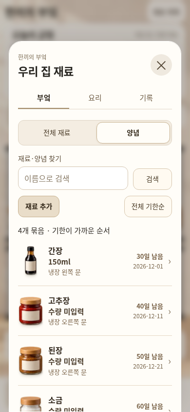
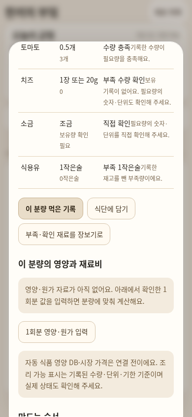
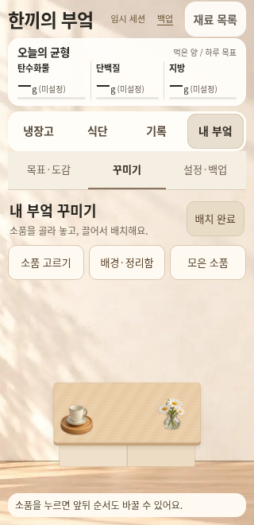

# 한끼의 부엌 · 목적에 맞춘 기능 이동

2026-11-02 Asia/Seoul. 사용자는 ‘양념 선반’과 ‘조리대’가 무슨 일을 하는 탭인지 물은 뒤 재검토·수정을 요청했다. 같은 따뜻한 흰색 4도어 외형과 메인 냉장고/식단/기록/내 부엌은 유지하고, 각 기능을 실제 사용하는 위치로 정리한다.

| 확인한 문제 | 수정한 흐름 |
| --- | --- |
| 빈 양념 선반을 별도 기능처럼 보여주지만 실제 양념은 냉장고 문에 있다. | 보조 공간 탭을 제거한다. 냉장고의 ‘재료·양념 보기’에서 전체 재료/양념 필터를 제공하고, 같은 묶음의 수량·기한·개봉일을 수정한다. |
| 레시피의 ‘조리대에 놓기’는 그림만 바꾸며 계획/기록과 경쟁한다. | 이 버튼을 제거하고 식단에 넣기·먹은 식사 기록·부족 재료 장보기·영양/원가 입력을 유지한다. |
| 요리 그림·재고·소품 배치가 같은 조리대에 섞여 있다. | 내 부엌 → 꾸미기에서 실제 소품 캔버스와 소품 고르기/배경·정리함/모은 소품/배치 완료를 제공한다. 완료하면 같은 내 부엌의 목표·도감으로 돌아가고, 메인 냉장고를 누르면 냉장고 장면을 복원한다. |
| 보조 공간 탭이 작은 냉장고의 높이를 계속 소비한다. | 추가 바로가기 행을 넣지 않고 약50px를 냉장고 장면에 돌려준다. |

## 데이터와 기존 기능

장면을 새로 만드는 대신 같은 `.kitchen-view` DOM을 냉장고 host와 꾸미기 host 사이에서 옮긴다. 화면 이동은 재료/소품 원문을 바꾸지 않는다. 꾸미기에서는 소품만 보여주며 counter에 있던 음식·양념·요리 기록은 원래 world에 남긴다. 냉장고 밖 양념/재료는 전체 목록에서 계속 조회·수정할 수 있고 저장 시 목록으로 복귀한다. 보관 온도를 추정하지 않으며 기존 zone ID, 좌표, 층, 키 `miniature-kitchen-preview-v1`, envelope version1은 유지한다.

문·식재료/문 양념 드래그·식사 분량/차감·취소·예산·영양·도감·보상·사진 OCR 경로를 유지한다. 전체 사진 객체 판별·새 미니어처 생성·공식 영양/가격·개인 권장량·기기 간 동기화는 이번 UI 변경으로 구현된 기능이 아니다. 운영 진입점/main/Pages 설정은 바꾸지 않는다.

## 최종 검증

고정 UI 소스는 `e0caf3e296a3cde73e1fb294e2c5db245712e437`다. 이후 근거 커밋은 생성 HTML을 변경하지 않는다. 검증은 예시 재고·테스트용 수동 기록으로 수행했다.

| 검사 | 실제 결과와 근거 |
| --- | --- |
| 생성·전송 | 앱1,021,849B / 위젯1,021,852B, 모바일 wrapper1,047,625B / 1,047,634B. 각1MiB 이내이며 [크기·SHA256](kitchen-purpose/generated-files.json)과 실제 검사/공개 원문이 일치한다. 같은8개 인코딩 이미지 바이트를 보존했고 사용하지 않는 공간 탭·선반 스타일만 정리했다. 전송 단위검사2/2 통과. |
| 브라우저 | **84/84 통과**, JS예외0. [요약](kitchen-purpose/summary.json), [탭/목적 흐름12](kitchen-purpose/tabs-results.json), [실제 식단·식사·예산22](kitchen-purpose/flow-results.json), [가독성23](kitchen-purpose/readability-results.json), [냉장고 회귀27](kitchen-purpose/regression-results.json). |
| 새 실제 흐름 | 양념 전체/종류 필터와 ‘부엌’ 선택 표시, 기존 냉장고 밖 양념4묶음/음식 수정의 zone·좌표 유지, 레시피→실제 계획/식사 form, 꾸미기 진입/완료/재진입, 실제 소품 드래그 후 재로드 보존, PC 바로가기→같은 편집 화면을 검사했다. 화면만 이동할 때 envelope가 완전히 같다. |
| 동일 상태 전후4개 | 앱/위젯390·1120, 같은 원본 envelope·Nov1·문4개 열림·선택 없음. 문서 높이844/1000px 유지·가로 넘침0·하단 겹침0. 냉장고 native 크기는390에서 **9.884%**,1120에서 **8.691% 증가**했고 원래 비율·중앙 배치·배경 바닥선을 유지한다. [비교](kitchen-purpose/comparison.json), [전 manifest](kitchen-purpose/before-manifest.json), [후](kitchen-purpose/after-manifest.json), [시각 검토/바닥선8개](kitchen-purpose/visual-review.json). |
| 상황 화면5개 | 일반·opaque 및PC에서 실제 양념 필터, 요리 계획/기록 버튼, 내부엌 꾸미기, 완료/냉장고 복귀를 조작하고 기록/장면 복원을 확인했다. [실제 흐름](kitchen-purpose/context-results.json). |
| 실제 공개 HTTPS | 앱/위젯×649×900·390×844·320×660 **6/6**, 원래CDN OCR **2/2** 통과. HTTP200·실제rawSHA256=고정git원문·JS0·터치/문/양념·식단·예산·사진 검수 경로를 확인했다. PC사이드바는1120×1000으로 실제 확장해 검사했다. [최종 공개 결과](kitchen-purpose/public-results.json), [실행](https://github.com/Ohoredingdong/Notion/actions/runs/41413081274). 앞선728339d2의 결과는 최종 결과로 재사용하지 않았다. |

실기기·Safari·실제 Notion 호스트는 이번 브라우저 크기/공개 검사 범위와 구분한다. 기존 회귀의320×568처럼 매우 낮은 화면에서는 일부 재료명이 밀집해 보이며, 기능 통과를 모든 높이에서의 주석 가독성 보장으로 취급하지 않는다. 이 경우의 별도 축약 표시/확대 읽기는 후속 검토다. 공개 iframe은 임시 세션이므로 닫기 전에 헤더의 백업으로 기록을 보관한다.

## 실제 화면

[냉장고 변경 전](kitchen-purpose/app-390-before.png) / [변경 후](kitchen-purpose/app-390-after.png) · [위젯](kitchen-purpose/widget-390-after.png) · [PC](kitchen-purpose/app-1120-after.png) · [320px 공개 프레임](kitchen-purpose/app-320-opaque.png).

| 양념 관리 | 실제 계획·식사 기록 | 내 부엌 꾸미기 |
| --- | --- | --- |
|  |  |  |

[PC 바로가기에서 연 같은 편집기](kitchen-purpose/desktop-decor.png).

## 공개 확인과 반영 상태

- [앱 열기](https://htmlpreview.github.io/?https://raw.githubusercontent.com/Ohoredingdong/Notion/e0caf3e296a3cde73e1fb294e2c5db245712e437/previews/mobile/app.html)
- [위젯 열기](https://htmlpreview.github.io/?https://raw.githubusercontent.com/Ohoredingdong/Notion/e0caf3e296a3cde73e1fb294e2c5db245712e437/previews/mobile/widget.html)

`fix/kitchen-purpose-navigation`에 push했다. base `feat/kitchen-tab-navigation`로 PR 생성 시도는 GitHub GraphQL API403 Forbidden으로 실패했다. [PR 비교/작성](https://github.com/Ohoredingdong/Notion/compare/feat/kitchen-tab-navigation...fix/kitchen-purpose-navigation?expand=1).

검증용 CI는 `delivery/verify-kitchen-purpose-20261102`, 결과는 `preview/kitchen-purpose-validation-20261102`에만 게시했다. main·Pages 설정·운영 진입점과 운영 데이터는 변경하지 않았다.
