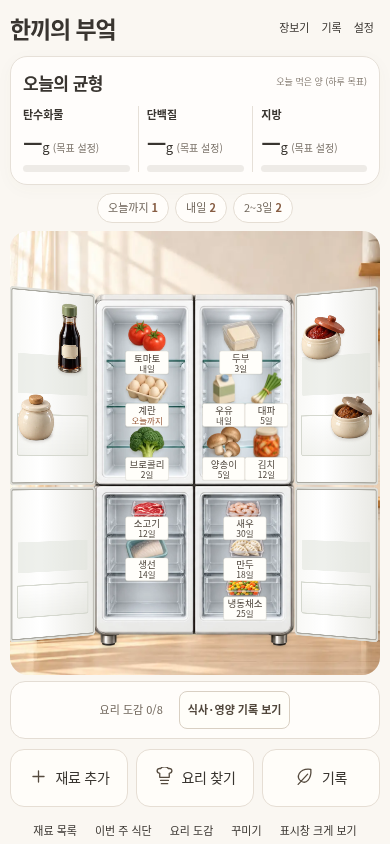
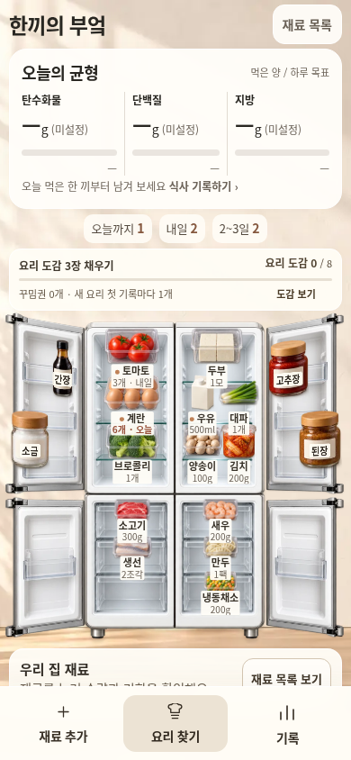

# 한끼의 부엌 · 가독성과 미니어처 부엌 재구성

기준일: 2026-11-01 Asia/Seoul. 변경 전 `4cf96c69`, 작업 브랜치 `feat/kitchen-readability-redesign`.

사용자는 현재 디자인의 문제점을 검토한 뒤 “가독성도 별로고 디자인 디테일도 투박해 수정 싹해봐”라고 요청했다. 이번 변경은 선택한 **흰색 4도어·따뜻한 아이보리/린넨/우드·중립색·탄단지 현재량(목표량)** 방향 안에서 장면과 조작 흐름을 함께 정리한다. 진녹색/파랑 중심 테마, 캐릭터 육성, 새 유료 재화는 추가하지 않는다. 구현 결과의 시각 검수와 main 배포는 별도다.

## 문제와 변경

| 확인한 문제 | 현재 소스의 변경 |
| --- | --- |
| 냉장고 그림과 주변 조작부가 별도 카드처럼 분리됨 | 따뜻한 벽·햇살·바닥을 전체 shell의 배경으로 연결하고 냉장고 장면의 설치 공간과 바닥 위치를 맞춘다. 작은 화면은 필요한 스크롤을 허용하며 주요 조작을 고정한다. |
| 열린 문은 얇은 판처럼 보이고 식재료의 재질·비례가 제각각임 | 문 안쪽 수납·투명 가드·힌지 자산과 같은 조명/시점의 식재료 아틀라스를 추가한다. 원본 자산은 보관하며, 기존 기본 재료와 양념에는 같은 계열의 그림을 쓴다. 매핑이 없는 사용자 재료는 기존 대체 그림/제품 사진 경로를 유지한다. |
| 작은 라벨만으로 수량·기한을 읽기 어려움 | 선반 라벨에 이름·수량을 표시하고, 선택한 재료의 전체 이름·수량·표시 기한을 별도 원문 요약으로 제공한다. 재료 목록과 상세 화면에서도 수량·기한을 먼저 읽게 한다. 원래 이름·기한·저장 위치를 축약된 화면 문구로 덮어쓰지 않는다. |
| 큰 버튼·링크·공간 탭이 여러 줄 반복됨 | **재료 추가·요리 찾기·기록**의 3개 행동을 고정 dock에 둔다. 공간 전환·주간 식단·도감·꾸미기·장보기·설정은 접힌 ‘부엌 도구와 꾸미기’에 남겨 기능을 제거하지 않는다. 상세 창의 이동은 부엌·요리·기록 3개로 통일한다. |
| 영양 목표 설정 전에 JSON 백업이 먼저 나옴 | 전용 `targets` 화면을 추가해 탄단지 목표를 직접 설정한다. 열량·수분·추가 성분은 선택 영역으로 묶고, 설정도 목표/선호를 먼저 배치한다. JSON 내보내기·가져오기는 접힌 백업/복구 도구로 옮긴다. 저장 차단/충돌 상태에서는 복구 도구를 열어 보여준다. |
| 큰 영양 카드가 빈 막대처럼 보임 | 현재 g(목표 g)와 실제 목표 대비 %를 함께 표시한다. 미입력·목표 미설정·알려진 0을 구분하고, 첫 식사 기록 안내와 부분 입력 건수를 제공한다. 존재하지 않는 섭취량을 예시 수치로 채우지 않는다. |
| 재료에서 요리를 찾으면 입력 조건부터 길게 보임 | 요리 결과와 재료 기록 정보를 먼저 보여주고 조건은 접어서 조정한다. 기존 8종 레시피·시간·조리법은 유지한다. 이름 일치를 실제 수량 충족으로 표시하지 않고, 원가가 없으면 미입력으로 표시한다. |
| 도감·목표·보상이 대표 화면에서 잘 드러나지 않음 | 실제 기록에 따른 선택 목표·도감 진행·꾸밈권을 부엌에 표시한다. 기존에 장착한 소품은 닫힌 문뿐 아니라 열린 냉동 문 안쪽에도 렌더링한다. 기존 보상 ID·비용·첫 요리 지급/취소 정책은 유지한다. |
| 입력 화면의 작은 글자와 불규칙한 간격 | 본문/보조 정보의 대비, 입력 높이와 간격, 카드의 정보 위계를 다시 정리한다. 입력 글자는 작은 화면에서도 16px를 기준으로 하며, 기한·수량·행동을 우선한다. 실제 iPhone의 자동 확대까지 검증됐다는 의미는 아니다. |

## 실제 터치 후 이어지는 클릭 처리

재료를 누르면 `pointerup`에서 기존 장면 DOM을 교체하고 상세 창을 연다. 같은 물리적 제스처의 후속 호환 클릭이 새 창의 버튼 위치에 닿으면, 사용자가 고르지 않은 행동이 추가로 실행될 수 있다.

`scene.js`는 완료한 재료 포인터의 ID·좌표·시각을 기록하고, **같은 제스처 뒤의 신뢰된 근거리 클릭**만 소비한다. 다음 물리적 `pointerdown`은 별도로 취급하고 키보드 클릭은 막지 않는다. 입력 이벤트 전체를 끄거나 터치 자체를 저장으로 간주하지 않는다. 드래그 종료도 이 처리와 함께 검증하며 dock·창·도구 영역을 재료 드롭 위치로 사용하지 않는다.

이 수정은 320px의 실제 터치 이벤트를 포함한 생성 HTML 검사 대상으로 둔다. 합성 DOM 클릭 통과와 모바일 프로필의 실제 터치 통과, 실물 휴대폰/Safari/Notion 검증을 구분한다. 최종 생성 HTML의 실제 터치 검사에서 앱·위젯 모두 상세 창이 350ms 뒤에도 유지되고, 다음 물리적 버튼 터치는 정상 실행되는 것을 확인했다. 최초 실패와 trusted 호환 클릭 추적은 외부 검사 폴더에 보존했다.

## 소스·생성 파일·데이터 경계

- 공통 화면: `designs/miniature-kitchen/scene.html`, `neutral.css`, `scene.js`, `workflows.js`.
- 소품 표시: `designs/miniature-kitchen/play-ui.js`. 보상 계산 모델은 기존 `play-model.js`를 따른다.
- 새 자산: `designs/miniature-kitchen/assets/door-insides.png`, `pantry-food-atlas.png`. 기존 냉장고/배경/구버전 자산을 삭제하지 않는다.
- 생성기: `scripts/build_miniature_kitchen_preview.py`. 앱·위젯과 공개용 wrapper는 같은 공통 소스에서 생성한다.
- 생성 대상: `previews/miniature-kitchen-{app,widget,board}.html`, `previews/mobile/{app,widget}.html`.

운영 진입점 `use-me-first.html`·`use-me-first-widget.html`, 기존 GitHub Pages/Notion URL, 원래 운영 저장 키는 유지한다. 운영 기록을 이번 화면으로 자동 이전하거나 합치지 않는다.

시안 키 **`miniature-kitchen-preview-v1`**, envelope **version 1**, 기존 world/play/workflow 형식을 유지한다. 화면 배치 변경은 저장된 재료의 ID·수량·기한·좌표·앞뒤 순서·문 상태를 다시 쓰는 이유가 아니다. 예시 재료의 현재 날짜 생성은 새로운 시안 상태에만 적용하고 이미 저장된 날짜는 갱신하지 않는다.

일반 출처에서 실행하면 기존 시안 저장 경로를 사용한다. 공개 HTMLPreview wrapper는 `allow-scripts allow-forms`의 opaque 프레임이며 `allow-same-origin`을 추가하지 않는다. 따라서 공개 검토 링크는 **임시 세션**이고, 설정의 백업/복구로 보관할 수 있다. 저장 불가·원본 손상·다른 탭과의 충돌 상태도 기존 보호 경로를 유지한다.

## 연결된 기능과 미연결 기능

실제 UI는 기존 수동 재료·양념 관리, 사진을 보며 직접 검수하는 등록, 식사 기록과 확인한 수량의 차감/수정/취소/복구, 주간 식단, 장보기/실구매/식비, 영양제, 월간, 도감·소품 선택으로 이어진다. 이번 외형 변경이 그 모델을 새로 구현하거나 데이터를 소급 계산한 것은 아니다.

다음 기능은 여전히 미연결이다.

- 제품/기한 사진 OCR, 냉장고 전체 사진의 자동 후보 인식, 사진 기반 새 미니어처 생성.
- 식품별 자동 영양 DB·가격 데이터·공식 개인 권장량·개인 건강정보 산출.
- 기기 간 동기화 및 운영 앱 기록과의 자동 연결.

영양·원가·목표는 직접 입력한 값과 기존 산식의 범위에서 표시한다. 원가 예상과 실제 지출을 중복 합산하지 않고, 미입력 영양을 0으로 만들거나 건강 점수·추가 섭취 보상을 만들지 않는다. 개인화/동기화/인식이 연결된 것처럼 표시하지 않는다.

## 검증과 검토 증거

빌드·테스트·브라우저 산출물은 저장소 밖에 둔다. 의도적으로 선택한 전후 이미지와 JSON만 검토 문서에 포함한다. 이전 작업의 통과 수치를 이번 변경의 최종 결과로 재사용하지 않는다.

```bash
source /workspace/.notion-cloud/activate.sh
python scripts/build_miniature_kitchen_preview.py --compact
python scripts/build_kitchen_mobile_preview.py
python scripts/test_kitchen_readability_browser.py --root previews --output /tmp/kitchen-readable-browser
python scripts/test_open_fridge_neutral_browser.py --root previews --output /tmp/kitchen-existing-flows
node --test tests/*.test.cjs
PYTHONPATH="$PWD:$PWD/scripts" python -m unittest discover -s scripts -p 'test_*.py'
```

| 항목 | 실제 결과/증거 |
| --- | --- |
| 생성 HTML | 앱 978,368B, 위젯 978,371B. 공개 wrapper 1,031,446B / 1,031,455B로 각각 1MiB 이내. 검사한 파일과 추적 생성 파일이 바이트 단위로 같다. [크기·SHA256](kitchen-readability/generated-files.json). |
| Node / Python 회귀 | Node 177/177, 최종 Python 262/262 통과. 최종 JS 구문 및 git diff 공백 검사 통과. |
| 가독성·실제 조작 | 새 검사 **23/23**, 기존 흐름 **27/27**, 관찰된 JavaScript 예외 0. [새 검사](kitchen-readability/readability-results.json), [기존 검사](kitchen-readability/regression-results.json). |
| 터치·드래그 | 320/390px의 앱·위젯 opaque 프레임에서 실제 터치. 양념 기한 저장·350ms 상세 유지·다음 버튼 동작, 문 개폐, 첫 프레임 가림, dock 위 드롭 취소를 확인했다. |
| 데이터 보존 | 100자 연속 이름·80자 비정형 수량, 과거 기한·정확한 좌표·미지의 v1 envelope 필드·운영 저장 키 보존 검사 통과. |
| 같은 조건의 전후 비교 | 앱·위젯 각각 320×660 / 390×844 / 1120×1000. 고정한 날짜와 최초 world·문·선택 상태가 전후 정확히 같다. [상태/레이아웃 비교](kitchen-readability/comparison.json). |
| 도감과 보상 | 실제 첫 요리 기록→꾸밈권→세라믹 타일 구매/장착 후, 네 문이 열린 상태에서 타일과 1/8 도감 상태를 확인했다. [검사 화면](kitchen-readability/earned-open-kitchen.png). 영양 미입력은 여전히 미입력이다. |
| 공개 HTTPS 실행 | **6/6 통과**. 앱·위젯 × 649×900 / 390×844 / 320×660, 실제 HTTP 200·raw SHA256 일치·JS 예외 0. 4문 독립 제스처·첫 프레임 가림·350ms 양념 상세 유지·정확한 저장·직접 목표·주요 기록 메뉴·하단 버튼을 검증했다. [결과](kitchen-readability/public-results.json), [실행](https://github.com/Ohoredingdong/Notion/actions/runs/41286584584). |
| 브랜치/PR/main | `feat/kitchen-readability-redesign`에 push 완료. `fix/kitchen-ui-details`를 base로 PR 생성 시도했으나 `https://api.github.com/graphql: Forbidden`(403)으로 생성되지 않았다. main과 운영 진입점은 변경하지 않았다. |

### 같은 데이터로 비교한 첫 화면

| 390×844 변경 전 | 390×844 변경 후 |
| --- | --- |
|  |  |

[320px 변경 전](kitchen-readability/app-320-before.png) · [변경 후](kitchen-readability/app-320-after.png) · [PC 변경 전](kitchen-readability/app-1120-before.png) · [변경 후](kitchen-readability/app-1120-after.png)

[재료 상세](kitchen-readability/app-390-item.png) · [320px 재료 목록](kitchen-readability/app-320-inventory.png) · [요리 결과](kitchen-readability/app-390-recipes.png) · [직접 목표 설정](kitchen-readability/app-390-targets.png) · [조리대](kitchen-readability/app-390-counter.png)

작은 선반 라벨은 이름·수량을 우선한다. 두 칸이 나란한 냉장 오른쪽에서는 짧은 기한 문구를 생략하고 임박점으로 표시하며, 전체 날짜와 긴 이름·수량은 선택 요약/목록/상세에서 읽는다. 320px에서는 냉장고를 더 축소하지 않고 화면 아래를 스크롤한다. PC의 큰 냉장고도 필요한 세로 스크롤을 사용하며 dock는 화면 아래에 유지한다.

시각 검수는 벽/바닥과 냉장고 위치, 문·수납·식재료의 비례, 라벨과 그림의 겹침, 수량·기한의 읽기, 고정 dock와 입력 화면의 가림을 따로 확인한다. 기능 검사 통과만으로 최종 디자인 승인이나 실기기 검증을 보고하지 않는다.


## 실제 실행한 공개 검토 링크

고정 소스: `f855795d25144b3674ffb1c1961bb9ff5f9925e6`. 후속 문서 커밋은 이 생성 HTML을 변경하지 않는다.

- [앱 열기](https://htmlpreview.github.io/?https://raw.githubusercontent.com/Ohoredingdong/Notion/f855795d25144b3674ffb1c1961bb9ff5f9925e6/previews/mobile/app.html)
- [위젯 열기](https://htmlpreview.github.io/?https://raw.githubusercontent.com/Ohoredingdong/Notion/f855795d25144b3674ffb1c1961bb9ff5f9925e6/previews/mobile/widget.html)
- [PR 작성 비교 화면](https://github.com/Ohoredingdong/Notion/compare/fix/kitchen-ui-details...feat/kitchen-readability-redesign?expand=1) — API 제한으로 PR 자체는 생성하지 못했다.

실제 공개 검증은 격리된 `delivery/verify-kitchen-readable-20261101`에서 수행했고, 합성 검사 결과만 `preview/kitchen-readable-validation-20261101`에 게시했다. 운영 브랜치/Pages 설정을 바꾸지 않았다. 이 링크는 opaque 프레임의 임시 세션이며, 검토 중 필요한 기록은 설정·백업에서 보관한다. 물리 iPhone/Android, Safari 및 실제 Notion 임베드 검증은 포함하지 않는다.
