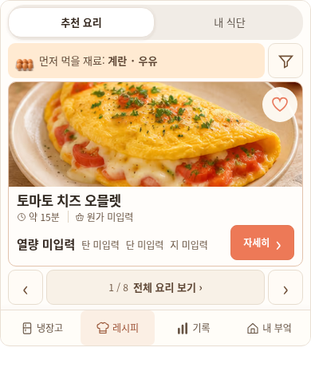
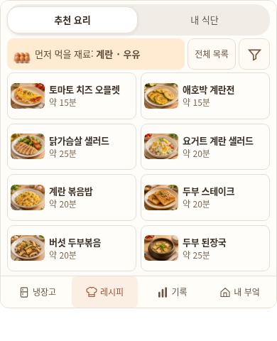

# 추천 레시피 8개 카드

사용자가 레시피를 한 장씩 보여주지 말고 약8개 카드를 함께 보여 달라고 요청했다. `feat/kitchen-eight-recipe-cards-20261106`에서 이전 `86a74fe5`를 기준으로 B1 추천 목록만 바꾼다. 냉장고 구도·위젯 크기·다른 탭·데이터 모델과 운영 배포는 유지한다.

`home-recipe-view.js`는 실제 추천 순서에서 최대8개를 골라2열×4행 카드로 표시한다. 각 카드에는 기존 사진·전체 요리명·시간을 넣고 카드 전체를 기존 상세 진입 버튼으로 사용한다. 단일 요리를 넘기던 페이징은 제거했다. 전체 목록과 필터는 위쪽44px 조작으로 유지하며 영양·원가·찜·계획·실제 식사는 상세에서 이어진다. 필터 결과가 적으면 그 개수만 표시하고0건은 빈 상태와 조건 초기화를 제공한다. 예시 요리를 추가하거나 임의 영양값으로 채우지 않는다.

`widget-panels.css`는 위젯 높이를 늘리지 않고 카드8개를 맞춘다.320×360에서도 긴 이름을 잘라 숨기지 않으며 카드 전체의44px 이상 조작과4:3 사진을 유지한다. 공통 렌더러를 쓰는 앱에도 같은 목록 스타일을 적용하고 다른 세 탭은 보존한다. 저장 키 `miniature-kitchen-preview-v1`·version1과 기존 계획 페이징은 바꾸지 않는다.

## 실제 화면과 검증

| 390px 이전 한 장 | 390px 수정8개 |
| --- | --- |
|  |  |

[320px 위젯](kitchen-eight-cards-20261106/recipes-320.png) · [넓은 위젯](kitchen-eight-cards-20261106/recipes-wide.png) · [요리 상세](kitchen-eight-cards-20261106/recipe-detail-320.png). 실제 Chromium 캡처이며 기존 카탈로그/격리 QA 자료를 사용한다. 비교표는 동일390×480 원본이다. 별도 공유용 [390px 카드 이미지](kitchen-eight-cards-20261106/recipes-390.png)만 실제 카드 경계로 잘랐고 UI나 사진을 합성하지 않았다.

[파일 해시](kitchen-eight-cards-20261106/build-manifest.json)와 [검증 결과](kitchen-eight-cards-20261106/verification.json)는 최종 고정4파일을 기준으로 기록한다. 전체 로그·결과·스크린샷은 체크아웃 밖 `/workspace/.notion-cloud/kitchen-eight-cards-20261106/`에 보존한다.

최종 고정본 검사 결과는 위젯21사례·4,289단언, 앱 레시피2사례·364단언, 기존 레시피 트랜잭션2스위트·6프로필, Node233건·전송12건 통과다. 카드→해당 상세를128회 실제 클릭했고, 다른 앱6화면 픽셀 변화는0이다. 기존 데이터·자산·워크플로·다른 JS 등538경로의 원문도 같다. 나머지 기록/성장 업무 스위트는 이번에 재실행하지 않았으며, 화면 회귀와 소스 보존 검사를 수행한 범위로 구분한다.

위젯 회귀 검사는 기본14개 native/opaque 크기에서8개 실제 ID/사진/이름·시간·44px·가림·각 카드 상세 연결을 검사한다. 실제 필터 입력/저장/초기화로15분 결과·0건 상태를 검증하며 매 단계 v1 원문 보존을 확인한다. 기존 등록·B6 실제 저장/취소 검사도 유지한다. 앱 B1 두 화면은 의도한 변경으로 실제8개 카드 동작을 검사하고, 나머지6개 앱 화면은 기존 픽셀과 같아야 한다.

```bash
python scripts/test_kitchen_widget_browser.py --root /tmp/kitchen-after \
  --baseline-root /tmp/kitchen-before --check-app-unchanged \
  --allow-app-recipe-grid-change --browser-executable /usr/bin/chromium \
  --output /tmp/kitchen-grid-qa
```

`/tmp/kitchen-before`와 `/tmp/kitchen-after`는 기존 생성기로 각각 수정 전/후 소스에서 만든 고정 native/app·위젯 및 mobile4파일이다. 새 플래그는 B1의 의도한 변화만 허용하며 기본 `--check-app-unchanged`의8화면 엄격 검사는 유지한다. 외부 레시피 트랜잭션 검증도 새 B1 선택 방법에 맞추되 기존 계획/실제 식사·차감/취소·중복 저장·찜/노트·장보기 검증은 보존한다.

첫 자동 실행에서는 후보에만 추가한 상세/필터 동선을 앱 전후 촬영 사이에 넣어, 다른 두 화면 외곽의 안티앨리어싱7픽셀이 달랐다. 실패는 `widget-final/`에 보존했다. 동일한4탭 경로로 다시 촬영한 전후6화면과 동일 빌드 자기 대조16화면은 모두 차이0이었다. 앱의 전후 촬영을 먼저 같은 경로로 마치고 별도 카드/필터 동선을 수행하도록 QA 순서만 고쳤다. 제품이나 픽셀 차이0 단언은 바꾸지 않았다. 외부 업무 검증의 숨겨진 X 클릭 실패도 보존하고, 기존 실제 화면의 뒤로/닫기 버튼을 사용하는 helper만 교정했다.

공유 진입점은 `previews/mobile/widget.html`이다. 공개 파일의 접근과 실제 HTMLPreview 실행은 구별한다. 현재 환경에서는 HTMLPreview/GitHub API가403으로 차단되며 실제 Notion·Safari·휴대폰, OCR 제공자 호출은 이번 검증 범위가 아니다. opaque 공유본은 기존처럼 임시 저장이다. 자동 통과나 내부 화면 검토를 사용자 승인으로 해석하지 않으며 main 병합·운영 배포는 하지 않는다.
