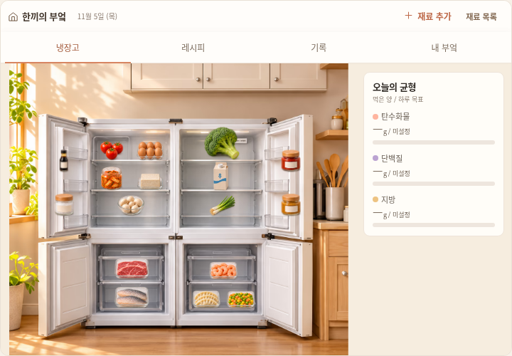
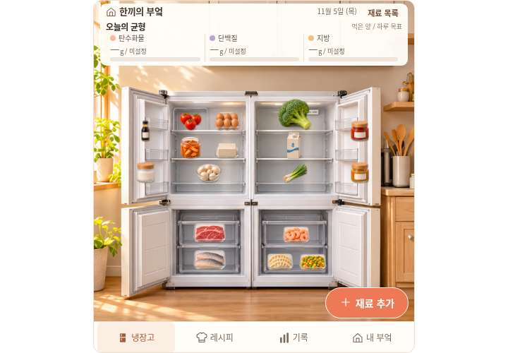
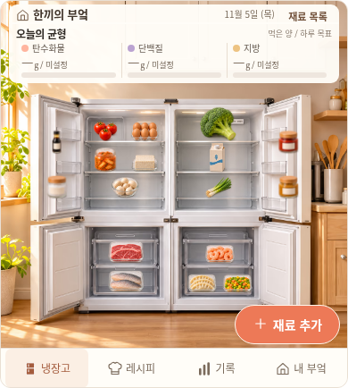
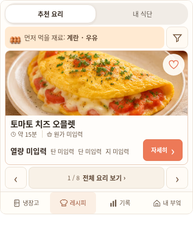
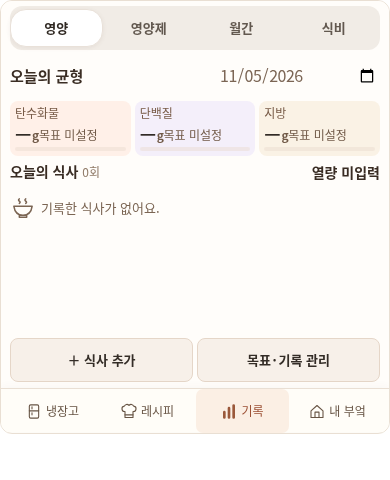
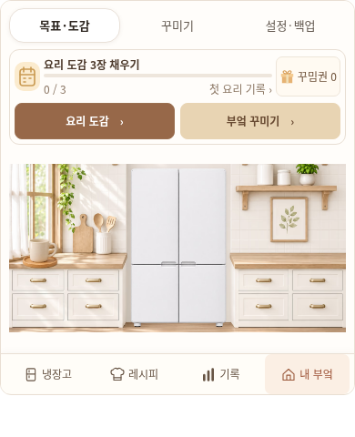

# 원래 시안의 위젯 구도 적용

기준은 사용자가 처음 첨부한 [재료 흐름 시안](../designs/kitchen-ux-storyboards/01-ingredients.png)과 기존 네 흐름이다. 사용자가 거절한 `80ae149d`의 기능 통과를 디자인 승인으로 취급하지 않는다. 작업 브랜치는 `fix/kitchen-reference-layout-20261106`이며 main·운영 사이트·금융 자동화는 변경하지 않는다.

## 실제 수정

- 연속된 부엌 사진 위에 가로 영양 요약을 복구했다. 오른쪽 영양판과 중복 상단 메뉴를 없애고, 재료 추가는 사진 안 우하단, 메인 메뉴는 하단 한곳에 둔다. 명칭은 냉장고·레시피·기록·내 부엌이다.
- 사진은 정사각 비율, 하단 메뉴는44px이다. 가용 폭·높이 안에 자연 비율로 맞추며 남는 임베드 바깥 영역은 투명하다. 넓고 낮은 호스트를 채우려고 사진을 늘리거나 카드 내부에 빈 판을 만들지 않는다. 561→562px에서 냉장고가 갑자기 줄어들던 분기를 제거했다.
- 레시피의 실제 사진·SVG atlas를 균일 비율로 표시한다. 일반 크기는 사진 아래 설명, 짧은 위젯은4:3 사진 옆 설명을 사용한다. 자세히 버튼은 흰 설명 영역에 두며 상세의 뒤로·즐겨찾기는 별도 도구줄에 둔다. 날짜·계획 카드·기록·식비 요약도 내용 크기로 정리했다.
- 등록 방법3개를 처음부터 표시한다. 사진2장 선택 화면의 수동 입력을 포함한 주요 조작을44px로 확보하고, 검수 화면은 필드만 내부 스크롤하며 저장·재촬영을 고정했다. 상세 창도 위젯 영역을 벗어나지 않는다.
- 기존 저장 키 `miniature-kitchen-preview-v1`·version1과 좌표·재고·계획·식사·지출·보상 모델을 유지한다. 시안의 예시 영양·재고를 실제 데이터에 넣지 않는다. 원본 앱은 별도이며8개 대표 화면의 전후 픽셀이 같다.

공유 진입점은 `previews/mobile/widget.html`, 원본 위젯은 `previews/miniature-kitchen-widget.html`이다. `app.html`이나 구형 운영 `use-me-first.html`을 수정 위젯으로 전달하지 않는다. 생성된 HTML은 직접 편집하지 않는다.

## 검증과 실제 화면

최종4파일은 `after-v3`에 고정한 뒤 검사했다. [파일 해시](kitchen-reference-20261106/build-manifest.json), [검증 요약](kitchen-reference-20261106/verification.json), [기존 자료 보존](kitchen-reference-20261106/preservation.json)을 확인한다. 전체 원시 로그와 PNG는 체크아웃 밖 `/workspace/.notion-cloud/kitchen-reference-20261106/`에 보존하고, 이 폴더에는 검토용 요약·선택 화면만 포함한다.

| 검사 | 결과 |
| --- | --- |
| native/opaque 위젯 회귀·이전 v1·실제 식사 완료 | 21사례·1,839검사, 기능·시안 구도 수치 검사 통과 |
| 레시피·기록·지출·성장 기존 업무 검증 | 8스위트·26프로필 통과 |
| 등록·계획·저장·상세 주요 조작 | 10프로필·90단계 통과, 320×360 포함 |
| 기존 앱 화면 보존 | 390×844·800×600의4탭, 8화면 픽셀 차이0 |
| 기존 Node 테스트·미리보기 전송 | 233건·12건 통과 |
| 기존 JSON/JSONL·자산·워크플로 등 | 524경로 원문 동일 |

같은 데이터·상태·호스트 크기로 비교했으며 아래 이미지는 실제 Chromium 캡처다. 날짜·내용은 격리된 QA 자료이며 개인 기록이나 실시간 데이터가 아니다. 홈의390px 카드 이미지만 실제 카드 경계로 잘랐고 사진을 늘리거나 UI를 합성하지 않았다.

| 720×500 이전 | 720×500 수정 |
| --- | --- |
|  |  |

| 냉장고 | 레시피 | 기록 | 내 부엌 |
| --- | --- | --- | --- |
|  |  |  |  |

작은 화면: [레시피320](kitchen-reference-20261106/recipes-320.png) · [상세320](kitchen-reference-20261106/recipe-detail-320.png) · [식사 완료320](kitchen-reference-20261106/meal-complete-320.png) · [등록 방법](kitchen-reference-20261106/registration-methods-320.png) · [사진 선택](kitchen-reference-20261106/registration-photos-320.png) · [검수·저장](kitchen-reference-20261106/registration-review-320.png). 등록 사진은 실제 파일 선택을 검증한 흰1px QA 이미지이며 사진 인식 결과나 실제 제품 사진 시안이라고 주장하지 않는다.

첫 후보에서 짧은 레시피 사진 프레임 비율과 등록 버튼 잘림이 실제로 실패했다. 최초 실패는 `widget-final/`, `focused-final/`에 보존했다. 두 번째 후보에서는 중앙 클릭 검사가 통과해도 사진 등록 버튼 행의 끝4px이 겹친다는 추가 관측이 나왔다. 상속된 앱용 sticky 위치·padding을 해제하고, 새 겹침 검사로 두 번째 후보의 실패를 확인한 뒤 같은 검사로 최종 후보를 재검증했다. 이전80ae를 당시 구도 검사에 넣은 음성 대조도 기능 통과·구도 실패로 종료1이었다. 기능과 구도 판정을 분리하고 실패를 성공으로 바꾸지 않았다.

재현 가능한 위젯 회귀 명령은 다음과 같다. 미리보기 생성 의존성과 환경은 AGENTS.md를 따르며 모든 출력은 저장소 밖에 둔다.

```bash
python scripts/build_miniature_kitchen_preview.py --compact --output-dir /tmp/kitchen-candidate
python scripts/build_kitchen_mobile_preview.py --output-dir /tmp/kitchen-candidate/mobile
python scripts/test_kitchen_widget_browser.py --root /tmp/kitchen-candidate \
  --baseline-root /tmp/kitchen-before --check-app-unchanged \
  --browser-executable /usr/bin/chromium --output /tmp/kitchen-verification
```

`/tmp/kitchen-before`는 수정 전 커밋에서 같은 생성기로 만든 고정4파일이어야 한다. 새 검사는 실제 사진 decode·atlas/crop·종횡비·텍스트 가림·44px 주요 조작·단일 메뉴·전환 경계와 기존 v1 원문을 확인한다. 등록 방법·사진 등록·직접 입력 검수의 초기 버튼과 터치 영역 겹침도 회귀 검사에 포함한다. QA 날짜는 단일 init script로 주입하고 제품의 실제 시계는 바꾸지 않는다. 외부 업무 검증 어댑터는 기존147개 assert AST를 보존하며, 이전 메뉴 위치를 가정하던 가시 영역 계산과 중복 시계 주입만 바로잡았다.

실제 캡처를 별도로 검토했지만 자동 검사나 내부 검토는 사용자 디자인 승인을 뜻하지 않는다. 실제 Notion·Safari·휴대폰은 미검증이다. 이 환경에서 HTMLPreview/GitHub API의403은 공개 실행·PR 생성의 접근 제한으로 구분한다. OCR 제공자 호출은 이번 검증에서 실행하지 않았고, opaque 공유 미리보기는 기존처럼 임시 저장이다. 병합·운영 배포는 별도 승인이 필요하다.
