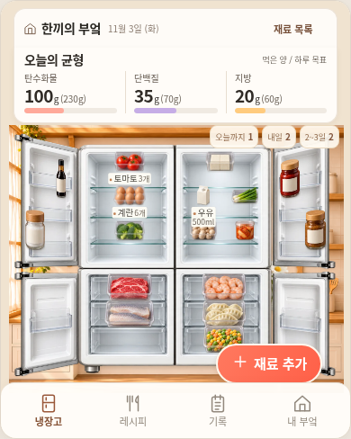

# 한끼의 부엌 · 승인 시안과 실제 화면의 외형 맞추기

2026-11-03 Asia/Seoul. 사용자는 앞선 위젯 적용 결과에 “왜 시안처럼 안 만들어 줘?”라고 지적했다. 이전 구현은 메뉴·기록·저장 흐름을 연결했지만 기존의 긴 냉장고, 빈 벽 배경과 별도 작업줄을 유지해 승인 이미지의 구도와 달랐다. 이번 작업은 [00 전체 동선·01 재료·02 요리·04 내 부엌](../designs/kitchen-ux-storyboards/DESIGN_SPEC.md)의 실제 모양과 배치를 맞추는 수정이다. 원본 설계 보드 PNG는 당시 제안 기록으로 보존하며 다시 그린 구현 화면으로 바꿔치기하지 않는다.

이전 작업의 기능 검사 통과를 디자인 승인이나 시안과의 시각적 일치로 취급하지 않는다. [앞선 적용 기록](KITCHEN_STORYBOARD_WIDGET_2026-11-02.md)은 당시 결과로 남기고, 아래 최종 후보의 화면·데이터·실행 근거를 별도로 고정한다.

## 달랐던 부분과 이번 수정

| 승인 시안에서 보이는 것 | 앞선 구현의 문제 | 이번 구현 기준 |
| --- | --- | --- |
| A1: 상단 요약 바로 아래의 넓은 냉장고와 가까운 창문·식물·수납장 | 세로로 긴 옛 냉장고를 큰 빈 벽·바닥 가운데에 배치 | 실제 빌트인 부엌 배경과 폭630×높이740의 논리 본체를 높이800 장면에 배치한다. 화면 높이에 맞추기 위해 빈 벽을 늘리지 않는다. |
| A1: 오른쪽 아래에 떠 있는 둥근 `재료 추가` | 바닥 아래 별도 소품 띠와 추가 버튼 행 | 별도 소품 띠를 없애고 추가 버튼을 냉장고 장면 오른쪽 아래에 겹친다. 적용된 실제 소품은 부엌의 조리대에 보인다. |
| A1: 그림을 읽게 하는 소수의 중요한 주석 | 모든 선반에 이름·수량을 반복 | 선택 재료와 오늘·내일·기한 경과 재료를 중심으로 주석을 보인다. 나머지 이름·수량·기한은 재료 터치와 목록에서 계속 확인한다. |
| B1: 음식 사진과 짧은 정보, 아래 두 요리 카드 | 흐릿한 접시 그림·중첩 카드·반복 제목 때문에 아래 카드가 잘림 | 가로 전체를 채우는 음식 사진, 간결한 영양/원가·부족 재료 정보와 주 행동, 두 보조 카드로 재구성한다. 예시 사진이 실제 입력 영양·원가를 대신하지 않는다. |
| D1: 목표 카드 아래를 채우는 닫힌 냉장고와 부엌 | 작은 냉장고 그림을 별도 카드 속에 넣음 | 목표·실제 진행과 요리 도감/꾸미기 버튼 아래에 실제 부엌 장면을 이어 붙인다. 적용된 소품을 동일한 보유·배치 상태에서 읽는다. |
| D5: 냉장고·양옆 가구가 편집 공간을 채움 | 큰 빈 벽 아래 작은 냉장고와 분리된 탁자 | 부엌 캔버스, `소품 / 배경 / 정리함`, 선택 소품의 `뒤로 / 앞으로 / 지우기`, `취소 / 적용`을 배치한다. 앞뒤 도구는 선택 소품의 층을 바꾸는 기능이다. |
| A3/A4: 사진과 핵심 입력, 분명한 저장 버튼 | 여러 선택 항목과 설명문이 한 번에 노출 | 사진 두 장과 이름·수량/단위·표시 기한·보관 위치를 먼저 보여 준다. 개봉일·종류·그림 선택·동일 묶음 선택 등 기존 추가 입력은 접을 수 있는 영역에 유지한다. |

위젯 홈은 너비 대비 높이1.25, 다른 허브는1.5를 기본 비율로 사용하며 실제 뷰포트 높이를 넘기지 않는다. 앱의 넓은 화면은 같은 소스와 동작을 사용한다. 긴 목록과 입력은 해당 영역에서 스크롤하며, 사진·검수·편집 단계의 뒤로/닫기와 맥락 복귀를 보존한다. 메인 메뉴는 **냉장고 / 레시피 / 기록 / 내 부엌**이다.

앞면은 큰 회색 표시창과 긴 손잡이가 지배하던 옛 그림에서, 승인04처럼 매끈한 진주빛 밝은 네 문과 절제된 손잡이를 가진 새 그림으로 바꾼다. `scene.js`의 `FRONT`가 새 앞면을 같은630×740 좌표에 연결하며, 기한·추천 데이터와 기존 표시창 관련 기능을 삭제하는 변경과 구분한다. 새 앞면은 PNG1159×1358의 물체 crop `[76,32,1007,1300]`을 네 문과 미리보기에 공통 사용한다. 열린 내부와 문 안쪽은 기존 그림을 유지한다. 닫힌 문 위의 작은 정보 패널은 중복 표시하지 않고 설정의 `표시창 확대`에서 같은 기한·추천 정보를 확인한다.

## 실제 데이터와 기존 동작

장면·사진·보이는 입력 위계를 바꾸며 `miniature-kitchen-preview-v1`, envelope version1과 기존 재료 ID·수량·기한·보관 위치·정규화 좌표를 교체하지 않는다. 시안처럼 선반을 채우기 위해 재료를 복제하거나 예시 목표·섭취량·예산을 기본 기록으로 넣지 않는다. 모르는 값은 실제0과 구분하고, 목표가 없으면 미설정으로 남긴다.

계획 저장과 실제 먹은 기록, 수량 전후·실행 취소, 장보기 예상과 실제 구매 지출, 영양제·월간 기록, 한 번의 도감 보상과 소품 보유권을 유지한다. 꾸미기는 적용 전 임시 상태에서 편집하며 취소 시 최신 재료와 이미 획득한 소품을 지우지 않는다. 사진 검수의 확인 전 저장 차단, 한국어 인라인 오류, 잘못 입력 중인 날짜 검사와 빈 선택 날짜 허용도 유지한다. 접힌 추가 입력에 오류가 있으면 그 영역을 열어 수정할 수 있게 한다.

원래 운영 진입점 `use-me-first.html`·`use-me-first-widget.html`, main·Pages 설정과 운영 데이터는 이번 검토 화면 수정 범위에서 바꾸지 않는다. 전체 냉장고 사진의 객체 자동 판별, 새 미니어처 자동 생성, 공식 성분·가격 DB, 개인 권장량·건강 조언, 기기 간 지속 저장·동기화는 이번 외형 수정으로 완료된 기능이 아니다.

## 이미지와 전송 예산

새 부엌 배경과 음식 사진은 의도적으로 교체한 디자인 자산이다. 기존 재료 미니어처의 해상도나 품질 설정을 낮춰 공간을 확보하는 방식으로 처리하지 않는다. 음식 사진을 사용하는 도감·카드 등에서 더 이상 사용하지 않는 옛 요리 셀과 교체한 옛 앞면은 최종 사용처를 확인해 전송 대상에서 정리한다. 알 수 없는 재료의 대체 그림은 유지한다. 따라서 이번 변경에 이전의 “인코딩 이미지8개 모두 동일”을 그대로 적용하지 않는다.

새 배경·음식 사진은 원본 PNG와 같은 해상도의 AVIF로 포함한다. 측정은 동일 원본 PNG를 크기 변경 없이 기존 범용 WebP82로 인코딩한 대조군과 비교했다. AVIF는 손실 이미지 코덱이며 다음 두 지표가 대조군 이상이라는 결과를 원본 무손실이나 모든 브라우저의 시각적 동일성으로 확대하지 않는다. 최종 실제 화면 검토는 별도 항목이다.

| 자산 | 원본 해상도 | 선택 AVIF / WebP82 크기 | PSNR: 선택 / 대조 | SSIM: 선택 / 대조 |
| --- | --- | --- | --- | --- |
| 요리 사진 아틀라스 | 1024×1536 | 152,387 / 253,710B | 35.1159 / 34.9093 | 0.948280 / 0.948204 |
| 빌트인 부엌 배경 | 1402×1122 | 34,592 / 64,518B | 39.4980 / 38.9082 | 0.969326 / 0.963961 |

측정 환경은 Sharp0.35.5·AOM3.15.1·libvips8.18.7·libheif1.23.5이며, 사진은 quality57/effort9, 배경은 quality50/effort7, 둘 다4:4:4다. 원본 PNG·인코딩 자산의 해시와 최종 새 앞면의 코덱·품질·크기는 최종 증거에 기록한다. 앞면 수치와 최종 자산 수를 이 중간 측정값으로 추정하지 않는다.

앱·위젯과 모바일 wrapper의 각 **1MiB 제한은 올리지 않는다.** 표준 gzip을 Base64로 담았을 때 상한을 넘으면 같은 gzip 바이트를 HTML에 안전한 Base85로 포장한다. RFC1924의 `&<>` 세 숫자를 `.,/`로 일대일 치환하므로 원문·그림·알파를 바꾸지 않고 텍스트 전송량을 줄인다. Base64와 Base85 모두 기존 내장 gunzip 디코더를 사용하고, Python 복원은 원래 UTF-8 길이·SHA256을 검사한다. Zopfli 의존성·상한 상향·추가 런타임 다운로드는 없다.

최종 새 앞면은 원본 해상도 WebP82로 저장하며 알파 픽셀은 원본과 정확히 같다. 배경과 요리 사진의 AVIF는 저장된 인코딩 자산을 사용하므로 일반 빌드에 Sharp/AOM 설치가 필요하지 않다. 생성 환경은 [기존 생성 안내](KITCHEN_STORYBOARD_WIDGET_2026-11-02.md#생성-환경)의 Python 표준 라이브러리·ImageMagick·Terser·clean-css다. 루트 npm 프로젝트를 만들지 않는다.

AVIF 이미지 표시는 Chrome85+·Firefox93+·Safari16+ 등 해당 플랫폼에서 AVIF 디코딩을 지원하는 브라우저가 필요하다. Safari의 버전·운영체제 조합별 지원과 실제 기기 동작은 별도 확인 대상이다. 원본 PNG를 보존하지만 이를 오래된 브라우저의 자동 런타임 fallback이라고 주장하지 않는다. 이번 실제 확인 범위는 아래에 기록할 브라우저로 한정하며 실기기 Safari·Notion 호스트 검증으로 확대하지 않는다. 이 호환성 사항은 구현 기록에 두며 제품의 기본 화면에 기술 안내를 반복하지 않는다.

## 최종 검증

수정 전 기준은 이전 위젯 전송물의 같은 날짜·원본 envelope·문 상태로 보관했다. 준비한 비교 규격은 기본10개, 명시적 입력4개, 상황8개다. 이 규격과 중간 `candidate-visual1`의 실행은 새 앞면을 포함한 최종 후보의 통과 수가 아니다. 최종 UI 소스는 `e1472f14904e33325049afbfb795ed773eb0c77c`이며 이후 증거 커밋은 생성 HTML을 바꾸지 않는다. [통합 요약](kitchen-fidelity/summary.json)에 같은 고정 전송물의 결과를 기록했다.

| 검사 | 확인 규격 | 최종 상태 |
| --- | --- | --- |
| 소스·생성물 고정 | 최종 후보의 source commit, 앱/위젯·mobile wrapper4개 크기/SHA, 복원 원문, 사용 이미지 해시 | 고정 UI 위 소스, [4파일·원문 해시](kitchen-fidelity/generated-files.json). native 앱1,008,259B/위젯1,008,265B, mobile1,009,606B/1,009,618B로 모두1MiB 이내. |
| 기본 동일 조건 전후10개 | 앱·위젯×320×568·390×560·390×844·649×600·1120×1000. 2026-11-03 Asia/Seoul·같은 원본 envelope·네 문 열림·선택 없음 | **10/10**. 원본 envelope 완전 일치·페이지 스크롤/가로 넘침/냉장고-내비게이션 겹침0. [전](kitchen-fidelity/before-manifest.json)/[후](kitchen-fidelity/after-manifest.json). |
| 입력된 기록4개 | 앱·위젯×390×560·390×844. 명시적인 합성 fixture의 탄100/단35/지20g·720kcal·목표230/70/60g을 표시하고 envelope 그대로 보존 | **4/4** 같은 fixture 완전 일치. [입력 비교](kitchen-fidelity/entered-manifest.json). 예시 기록을 원래 기본값으로 넣지 않았다. |
| 상황 비교8개 | 앱·위젯×닫힌 냉장고·선택 재료·레시피·꾸미기, 390×844·같은 날짜/진입 상태 | **8/8**, 각 진입 전후 envelope 완전 일치, JS0. [상황](kitchen-fidelity/contexts-manifest.json). |
| 승인 이미지와 실제 구도 | A1의 넓은 본체·요약/추가 버튼·선반 가독성, B1의 사진+두 카드, D1/D5의 실제 가구/앞면/소품·도구·적용/취소. 전체 뷰포트와 실제 컴포넌트를 각각 비교 | A1/B1/D5의 실제 PNG와 원본 시안을 대조했다. 넓은 본체·바로 이어지는 요약·사진/두 카드·가구/평평한 앞면·선택 도구를 확인했다. 픽셀 동일 아트나 사용자 최종 승인으로 주장하지 않는다. [검토 요약](kitchen-fidelity/qa-summary.json). |
| 기능·데이터·조작 | 재료/문/라벨의 실제 hit target·차폐, 목록/초안 복귀, 추가 입력 오류, 계획/기록/취소, 실제 지출, 편집/보상·데이터 보존과 키보드 초점 | **91/91·JS0**: [탭19](kitchen-fidelity/tabs-results.json), [흐름22](kitchen-fidelity/flow-results.json), [가독성23](kitchen-fidelity/readability-results.json), [회귀27](kitchen-fidelity/regression-results.json). 추가 [장면4](kitchen-fidelity/scene-results.json)·[앞면/알림3](kitchen-fidelity/front-toast-results.json)·[실제 재료 터치](kitchen-fidelity/food-hit-results.json)·[PC 소품 그림6](kitchen-fidelity/prop-projection-results.json) 통과. |
| 코덱·포장·전송 | 최종 새 앞면까지 포함한 해상도/품질 근거·각1MiB·gzip 복원·일반/opaque 실행과 실제 그림 로드 | 전송 단위검사 **12/12**. [자산 품질·정확한 앞면 알파·사용처/해시](kitchen-fidelity/codec-report.json). 최종 공개 브라우저에서도 실제 raw/native/srcdoc·복원 SHA와11모듈/6스타일이 정확히 일치하고 AVIF2개가 원본 해상도로 디코딩됐다. |
| 공개 HTTPS·이미지 표시 | 같은 고정 소스의 HTTP·raw/decoded SHA·실제 srcdoc/모듈/스타일·일반 크기/터치와 실제 AVIF/WebP 표시. 이번 공개 시각 검사는 OCR 엔진을 실행하지 않으며 제어 응답 검수 UI와 실제 문자 인식을 구분 | **6/6·JS0**, 앱/위젯×649×900·390×844·320×660. [실제 공개 결과](kitchen-fidelity/public-results.json), [실행](https://github.com/Ohoredingdong/Notion/actions/runs/41485292680). 한 번의 새 실행이며 OCR은 실행하지 않았다. 현재 사진 검수 UI 검증과 앞선 원래CDN 실제 인식 결과를 혼동하지 않는다. |
| 링크·브랜치·PR | 최종 확인한 앱/위젯·화면 이미지 URL, 작업 브랜치와 PR 생성/외부 차단 여부 | `fix/kitchen-storyboard-fidelity`에 push. base `feat/kitchen-storyboard-widget`로 draft PR 생성 시도는 GitHub GraphQL API403 Forbidden으로 실패했다. [PR 비교/작성](https://github.com/Ohoredingdong/Notion/compare/feat/kitchen-storyboard-widget...fix/kitchen-storyboard-fidelity?expand=1). main/Pages 설정은 바꾸지 않았다. |

기능 검사 통과와 사용자 디자인 승인은 별개다. 최종 검토에서는 이전 결과와 나란히 보아 시안의 외형에 가까워졌는지 먼저 판정하고, 기능·저장·공개 실행 결과를 그 근거와 함께 제시한다.

## 실제 수정 화면과 링크

[위젯 열기](https://htmlpreview.github.io/?https://raw.githubusercontent.com/Ohoredingdong/Notion/e1472f14904e33325049afbfb795ed773eb0c77c/previews/mobile/widget.html) · [앱 열기](https://htmlpreview.github.io/?https://raw.githubusercontent.com/Ohoredingdong/Notion/e1472f14904e33325049afbfb795ed773eb0c77c/previews/mobile/app.html). 공개 프레임은 임시 세션이며 기록은 화면의 백업 기능으로 보관한다.

[같은 예시 기록의 변경 전](kitchen-fidelity/widget-before-entered.png) / [변경 후 실제 컴포넌트](kitchen-fidelity/widget-home-entered.png). 아래 숫자는 시각 비교용 합성 입력이며 소스 기본값이나 실제 사용자 기록이 아니다.

[레시피](kitchen-fidelity/recipes.png) · [닫힌 문](kitchen-fidelity/closed.png) · [꾸미기](kitchen-fidelity/decor.png) · [320px](kitchen-fidelity/widget-320.png) · [PC](kitchen-fidelity/app-wide.png).
