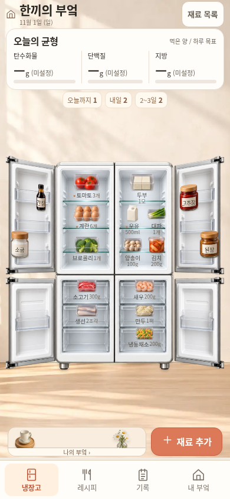
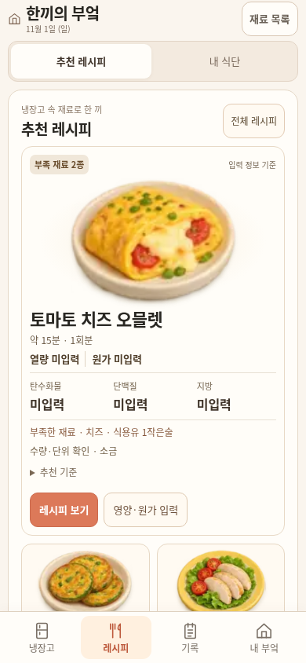
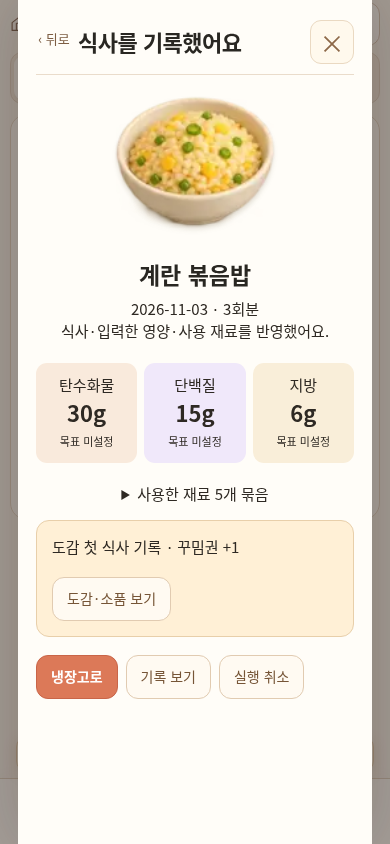

# 한끼의 부엌 · 동작 시안을 위젯에 적용

2026-11-02 Asia/Seoul. 사용자는 앞서 본 화면·동작 시안을 위젯에 적용하고, 메인 `식단` 메뉴를 `레시피`로 바꾸라고 요청했다. 이번 작업은 [설계 보드](../designs/kitchen-ux-storyboards/DESIGN_SPEC.md)를 실제 공통 앱·위젯 화면에 연결하는 후속 구현이다. 원본 설계 PNG는 제안 당시의 기록으로 보존하며, 이미지에 적힌 예시 영양·목표·예산을 실제 기록에 복사하지 않는다.

## 바뀐 화면과 연결

| 시작하는 곳 | 실제 화면과 다음 행동 |
| --- | --- |
| 하단 `냉장고` | 헤더·오늘의 탄단지 현재량(내 목표)·기한 요약·흰색 4도어 냉장고·재료 추가를 보여 준다. 재료를 누르면 상세, 헤더 `재료 목록`을 누르면 전체 목록을 연다. 적용된 소품은 홈의 작은 부엌 미리보기에도 반영한다. |
| 하단 `레시피` | `추천 레시피 / 내 식단`으로 나눈다. 실제 보유 수량·기한·입력 영양·원가에 따른 추천, 부족/확인할 재료, 전체 레시피 진입을 제공한다. `내 식단`의 계획 기능과 내부 route 이름은 유지한다. |
| 하단 `기록` | `영양 / 식비 / 영양제 / 월간`에서 각각 날짜별 실제 식사, 월 예산·구매 지출, 등록한 영양제와 오늘 체크, 달력·월 합계·입력한 탄단지 비율을 보여 준다. |
| 하단 `내 부엌` | `목표·도감 / 꾸미기 / 설정·백업`으로 나눈다. 선택한 목표의 실제 진행·도감·보유 소품과 꾸미기 진입, 저장 상태와 백업을 제공한다. |

메인 메뉴는 화면 아래 한곳에 둔다. 예전 상단 메인 탭과 별도의 두 버튼 고정 메뉴를 함께 반복하지 않는다. 양념 선반·조리대를 별도 탐색 탭으로 되살리지 않으며, 냉장고 밖의 기존 재료는 전체 목록의 보관 위치 필터로 관리한다. 재료 상세는 하단 시트, 등록·요리·기록은 집중 대화상자로 연다. 꾸미기 편집 중에는 메인 메뉴·브랜드·영양 요약을 숨기고 편집과 적용/취소에 집중한다.

따뜻한 아이보리·우드 배경, 흰색/실버 냉장고, 코럴 주 행동, 옅은 탄단지 색을 사용한다. 영양 요약은 냉장고 홈과 기록 화면의 해당 날짜에 표시하며 모든 입력 화면 위에 반복하지 않는다. 화면 높이에 맞춰 장면을 배치하고 긴 목록·입력은 내부 영역에서 스크롤한다. 작은 화면의 실제 크기·배경 바닥선·반응형 경계는 아래 최종 검증에서 별도로 판정한다.

## 재료 등록과 맥락 유지

재료 추가 → 제품·기한 사진 2장 → 기기 내 글자 OCR → **한 화면에서 원본 확인·수정·저장**으로 연결한다. OCR 검수 후 다시 같은 내용을 입력하는 두 번째 저장 화면을 거치지 않는다. 후보 이름·수량·기한과 원문을 보고 직접 고친 뒤 원본 확인 체크와 `확인하고 담기`로 확정한다. 사진 선택·읽기·화면 이동만으로 재고를 쓰지 않는다.

뒤로/닫기 후 다시 등록에 들어오면 선택 사진과 아직 저장하지 않은 수동 수정값을 유지한다. 사진 교체·재읽기는 최종 확인을 다시 받는다. `등록 취소`를 명시적으로 선택하고 확인한 경우에만 초안을 폐기하며, 확정 저장 후에는 그 초안이 다시 새 재료로 살아나지 않게 한다. 같은 이름도 기한·개봉일·단위가 다르면 별도 묶음이며 자동으로 합치지 않는다.

공개 터치 검사에서 확인 체크 없이 저장한 뒤 브라우저의 기본 필수 입력 팝업이 터치를 삼키는 현상을 재현했다. 최종 사진 검수 form은 `novalidate`로 기본 팝업을 띄우지 않고 기존 명시적 확인 검사와 각 입력의 `validity`를 읽어 한국어 안내를 표시한다. 필수 이름·잘못 입력 중인 날짜는 저장을 막고 실제로 비운 선택 날짜와 모르는 수량 원문은 유지한다. 확인 전 저장은 원래 데이터를 바꾸지 않으며, 오류 뒤에도 체크를 한 번 누르고 정상 저장할 수 있다.

목록의 `전체 / 식재료 / 양념`, 보관 위치, 검색과 스크롤을 상세 진입·뒤로가기에서 유지한다. 수정 저장 후에는 변경한 실제 수량·기한을 같은 목록 상태에 반영한다. 냉장고에서 연 상세를 닫으면 냉장고로 돌아온다. 등록·상세의 뒤로가기와 명시적 취소를 구분한다.

## 레시피의 계획과 먹은 기록

| 행동 | 반영 범위 |
| --- | --- |
| `식단에 넣기` | 날짜·끼니·분량을 확인해 계획만 저장한다. 재고·섭취 영양·실제 구매 지출을 바꾸지 않는다. 계획 화면을 열고 닫는 것만으로도 쓰기가 발생하지 않는다. |
| 계획의 `먹었어요` 또는 레시피의 식사 기록 | 계획/레시피·분량을 이어받고, 실제 먹은 날짜·양·입력 영양·사용할 묶음과 수량의 전→후를 확인한다. 호환되는 단위만 차감하며, 모르는 단위를 임의 g으로 바꾸지 않는다. |
| `식사 기록하기` | 식사·입력 영양·실제 재고 차감 내역을 한 거래로 반영한다. 완료 화면에 해당 식사·갱신된 하루 균형·사용 내역과 기록 보기/냉장고로/실행 취소를 제공한다. |
| 실행 취소 | 취소할 기록과 실제 복구량을 확인한 뒤 연결된 식사·영양·차감 거래를 역반영한다. 나중에 수정한 다른 기록 전체를 이전 상태로 덮어쓰지 않는다. |

완료한 계획을 재진입해 중복 기록하지 않으며 기존 기록으로 연결한다. 예상 레시피 원가는 실제 구매 지출에 더하지 않는다. 구매 확인에서 확정한 실제 가격·수량·날짜만 식비에 반영하며 장보기의 예상 금액과 구분한다.

## 기록과 꾸미기

영양 화면의 날짜를 바꾸면 그날의 실제 식사와 합계를 읽는다. 월간 화면은 선택한 연·월의 실제 날짜 수와 시작 요일을 계산하고, 기록일을 누르면 해당 날짜의 영양 기록으로 이동한다. 월 탄단지 에너지 비율은 세 값을 모두 입력한 식사만 계산 대상으로 표시한다. 영양 미입력은 0으로 간주하지 않고, 목표 미설정·원가 미입력·예산 미설정을 실제 0과 구분한다. 영양제 체크는 식사 영양 합계에 섞지 않는다.

꾸미기는 저장된 배치와 분리한 임시 상태에서 소품의 위치·앞뒤 순서, 배경·정리함·라벨, 문의 보상 소품을 미리 본다. `적용`할 때 변경한 꾸미기 항목만 저장하고 홈으로 돌아간다. `취소`하면 편집 전 배치·외형·문 소품으로 돌아간다. 적용되지 않은 배치는 홈 미리보기와 백업 원문에 섞지 않는다.

이미 교환해 획득한 소품의 보유권은 꾸미기 취소로 지우지 않는다. 편집 중 다른 경로에서 변경한 최신 식재료·식사 기록을 적용/취소로 덮어쓰지 않으며, 같은 꾸미기 항목의 동시 변경 충돌은 확인 없이 이전 값으로 되돌리지 않는다. 음식 드래그의 기존 저장 동작과 꾸미기 임시 배치를 구분한다. 첫 요리 기록의 보상 지급 규칙·보유 상태는 기존 모델을 유지하며, 도감 열람이나 취소·재기록으로 보상을 반복 지급하지 않는다.

## 데이터·생성·전송 경계

공통 구현은 `designs/miniature-kitchen/scene.html`, `home.js`, `storyboard.css`, `scene.js`, `workflows.js`, `play-ui.js`에서 앱·위젯에 함께 적용한다. `miniature-kitchen-preview-v1` 키, envelope version1, 원래 재료 ID·보관 위치·좌표와 기존 기록을 유지한다. 이번 디자인을 이유로 저장 형식을 교체하거나 기존 사용자 값을 데모로 재분류하지 않는다. 원래 운영 진입점 `use-me-first.html`·`use-me-first-widget.html`, main·Pages 설정·운영 데이터는 이번 시안 적용 범위에서 변경하지 않는다.

생성기는 이미지와 스크립트를 포함한 단일 HTML을 만들며 앱·위젯 및 모바일 wrapper **4개 전송 파일의 각 1MiB 제한**을 유지한다. 두 화면을 함께 담는 로컬 비교 보드는 이 전송 제한 대상이 아니다. 이미지 품질/해상도와 기능을 줄여 제한에 맞추지 않는다. CSS의 순서를 보존하는 로컬 minify와 모바일 wrapper의 inert text 전송을 사용한다. 모바일 wrapper는 entity를 복원한 원문을 `srcdoc`에 전달하고 `sandbox="allow-scripts allow-forms"` 경계를 유지한다. `allow-same-origin`을 추가하지 않으며 공개 미리보기는 임시 세션 상태와 백업 경로를 알린다.

제한을 넘는 compact HTML에만 손실 없는 gzip+base64 부트스트랩과 포함된 소형 디코더를 적용한다. Python 생성기는 복원한 원문의 UTF-8 바이트 수·SHA256을 검사하며, 브라우저는 포함된 디코더로 원문을 복원한 뒤 실행한다. `DecompressionStream`이나 실행 중 디코더 다운로드가 필요하지 않다. 정상 문서·중복 압축 방지·결정적 생성·손상/길이/SHA 불일치·특수 문자 전송을 단위검사7개로 검증했다. 비교 보드와 로컬 무압축 진단 파일을 실제 공개 전송물의 크기 근거로 쓰지 않는다.

### 생성 환경

Python3.12, ImageMagick `magick`과 다음 외부 Node 도구를 사용한다. 루트 npm 프로젝트를 만들지 않는다. 포함된 fflate0.8.2 gunzip 디코더와 MIT 라이선스는 `scripts/vendor/`에 있으므로 실행 중 디코더를 내려받지 않는다.

```bash
kitchen_build_tools=/tmp/notion-kitchen-build-tools
npm install --prefix "$kitchen_build_tools" --no-save --no-package-lock terser@5.44.1 clean-css-cli@5.6.3 clean-css@5.3.3
export KITCHEN_TERSER="$kitchen_build_tools/node_modules/.bin/terser"
export KITCHEN_CLEANCSS="$kitchen_build_tools/node_modules/.bin/cleancss"
python scripts/build_miniature_kitchen_preview.py --compact
python scripts/build_kitchen_mobile_preview.py
python -m unittest scripts/test_kitchen_mobile_transport.py
```

## 최종 검증

고정 UI 소스는 `3faf53841239e812a62ad8ca5091f3638bc54c41`다. 이후 문서·증거 커밋은 생성 HTML을 바꾸지 않는다. 예시 재고와 명시적인 테스트용 입력으로 검증했으며 이전 작업이나 중간 무압축 진단의 통과 수를 최종 전송물의 결과로 재사용하지 않았다.

| 검사 | 현재 기록 |
| --- | --- |
| 고정 UI 소스·생성 SHA256 | 위 소스의 실제 전송4개 바이트·SHA256과 복원 원문 해시를 [생성 기록](kitchen-storyboard-widget/generated-files.json)에 보관했다. |
| 크기·복원·전송 | 앱881,537B / 위젯881,544B, 모바일882,862B / 882,875B로 모두1MiB 이내. 복원 원문은 각각1,065,168B / 1,065,171B이며 기존8개 인코딩 이미지 바이트와 minify 모듈을 보존한다. 모바일 payload는 packed native와 정확히 같고 전송/압축 단위검사 **7/7 통과**. |
| 무압축/포장 브라우저 비교 | 일반/opaque 앱·위젯×3크기 **12/12**와 특수문자·HTMLPreview4개 통과. `DecompressionStream`을 비활성화한 상태에서 복원 UTF-8·실제 CSS/좌표·텍스트·envelope·저장 원문이 같고 외부 요청/JS예외0이다. [실제 비교](kitchen-storyboard-widget/packed-browser-results.json), [고정4파일/8이미지](kitchen-storyboard-widget/encoded-assets.json). 캡처5개는 픽셀 동일하며 나머지는 안티앨리어싱5~80픽셀·최대7/255 채널값 차이(화면0.04401% 이하)로 구분해 기록했다. 모든 캡처가 바이트/픽셀 동일하다고 주장하지 않는다. |
| 실제 브라우저 흐름 | 최종 packed 전송물로 **91/91 통과·JS0**. [요약](kitchen-storyboard-widget/summary.json), [탭/새 동작19](kitchen-storyboard-widget/tabs-results.json), [전체 흐름22](kitchen-storyboard-widget/flow-results.json), [가독성23](kitchen-storyboard-widget/readability-results.json), [회귀27](kitchen-storyboard-widget/regression-results.json). 등록 초안/저장 후 새 등록, 목록 필터·스크롤 복귀, 수량 전→후·실행 취소, 실제 기록/달력, 꾸미기 미리보기·적용/취소·동시 재고/보유권 보존 및 초점을 검사했다. OCR 제어 응답 검수와 실제 인식은 구분한다. |
| 사진 검수 오류 회복 | opaque390×844·DSF2 실제 터치 **4/4**에서 확인 전 저장 차단→한국어 안내→실제 한 번의 label 탭→한 번 저장/정확히 한 묶음·빈 이름 차단을 확인했다. [터치 회복](kitchen-storyboard-widget/photo-touch-recovery.json). 실제 PC 키보드로 표시 기한/개봉일을 부분 삭제해 `badInput`인 날짜의 저장을 각각 막고, 유효한 날짜를 복구한 뒤 한 번 저장하는 [날짜 검사1/1](kitchen-storyboard-widget/photo-native-date-validation.json)도 통과했다. 모르는 수량 원문과 실제 빈 선택 날짜는 보존했다. |
| 동일 상태 전후·시각 검토 | 앱/위젯×320×568·320×660·390×844·649×900·1120×1000 **10개**. 같은Nov1·원본 envelope·네 문 열림·선택 없음에서 데이터 완전 일치, 문서 높이=뷰포트, 가로 넘침0·하단 탭/장면 겹침0. [전후 비교](kitchen-storyboard-widget/comparison.json), [전 manifest](kitchen-storyboard-widget/before-manifest.json), [후](kitchen-storyboard-widget/after-manifest.json), [배경/발 위치10개](kitchen-storyboard-widget/background-geometry.json). 배경 바닥선 계산 오차0px, 프레임 발은 기존 의미대로 바닥선 아래8px. 320×568·390×844의 실제 글자/그림 및 집중 편집기 구도를 함께 검토했다. |
| 실제 공개 HTTPS·원래 CDN OCR | 같은 소스3faf5384의 앱/위젯×649×900·390×844·320×660 **6/6**, 원래CDN OCR **2/2 통과**. HTTP200·고정 raw SHA·실제 srcdoc/native 일치·복원 SHA 및 DOM의 실제10모듈/5스타일 일치를 확인했다. 실제 제품/기한 두 사진을 읽고 수정525mL·Nov30 한 묶음을 원본 확인 뒤 한 번 저장했으며 사진의 외부 POST는 없다. [통합 결과/실행별 출처](kitchen-storyboard-widget/public-results.json). [최초 실행](https://github.com/Ohoredingdong/Notion/actions/runs/41451929549)의4개 통과와 [사진 실행](https://github.com/Ohoredingdong/Notion/actions/runs/41452688715)의2개 통과를 합산했다. 최초 사진 동작도 저장까지 통과했으나 닫힌 dialog의 원래 review DOM까지 없어져야 한다는 잘못된 검사로 실행 전체는 실패했다. 실제 닫힘/보이지 않음·두 번째 수동 form 부재로 검사만 수정했고 UI 소스는 바꾸지 않았다. [최초 실패 원문](kitchen-storyboard-widget/public-first-run.json), [최종 사진 결과](kitchen-storyboard-widget/public-phone-retry.json)를 구분해 보존한다. |
| PR·공개 링크 | `feat/kitchen-storyboard-widget`에 push했다. base `design/kitchen-ux-storyboards`로 draft PR 생성을 시도했지만 GitHub GraphQL API403 Forbidden으로 생성되지 않았다. [PR 비교/작성](https://github.com/Ohoredingdong/Notion/compare/design/kitchen-ux-storyboards...feat/kitchen-storyboard-widget?expand=1). |

실제 휴대폰·Safari·Notion 호스트 검증은 Chromium의 모바일 크기·터치 모방·공개 iframe 실행과 구분한다. 전체 냉장고 사진의 객체 자동 판별, 새 미니어처 생성, 공식 성분·가격 DB, 개인별 권장량/건강 조언, 기기 간 지속 저장·동기화와 운영 데이터 연결은 이번 UI 변경의 완료 범위가 아니다.

## 실제 화면

[390px 변경 전](kitchen-storyboard-widget/app-390-before.png) / [변경 후](kitchen-storyboard-widget/app-390-after.png) · [320×568 변경 전](kitchen-storyboard-widget/widget-320-short-before.png) / [변경 후](kitchen-storyboard-widget/widget-320-short-after.png) · [PC](kitchen-storyboard-widget/app-1120-after.png).

| 위젯 홈 | 레시피 | 식사 완료 |
| --- | --- | --- |
|  |  |  |

[영양 화면의 테스트 입력](kitchen-storyboard-widget/nutrition-test-fixture.png) · [꾸미기 임시 배치의 테스트 입력](kitchen-storyboard-widget/decor-preview-test-fixture.png). 사진의 흰색1px 테스트 업로드를 실제 인식/표시 실패로 오인하지 않도록 제어 응답 A4 사진은 사용자용 화면 예시에서 제외한다.

[공개 환경에서 실제 OCR로 읽은 검수 화면](kitchen-storyboard-widget/photo-actual-ocr-review.png) · [확인 후 한 번 저장한 결과](kitchen-storyboard-widget/photo-actual-ocr-saved.png). 인식용 사진과 수량 수정은 합성 테스트 입력이다.

## 공개 검토 링크

- [위젯 열기](https://htmlpreview.github.io/?https://raw.githubusercontent.com/Ohoredingdong/Notion/3faf53841239e812a62ad8ca5091f3638bc54c41/previews/mobile/widget.html)
- [앱 열기](https://htmlpreview.github.io/?https://raw.githubusercontent.com/Ohoredingdong/Notion/3faf53841239e812a62ad8ca5091f3638bc54c41/previews/mobile/app.html)

공개 iframe은 임시 세션이며 실제 화면의 백업 경로로 기록을 보관한다. 검증용 CI와 결과는 `delivery/verify-kitchen-storyboard-apply-20261102`, `preview/kitchen-storyboard-apply-validation-20261102`에만 게시한다.
