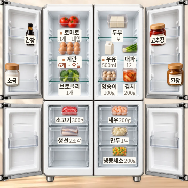
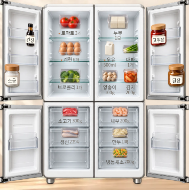

# 한끼의 부엌 · 그림을 돕는 작은 주석

기준일: 2026-11-01 Asia/Seoul. 사용자가 냉장고의 글씨가 그림보다 지배적이라고 지적했다. 이번 수정은 식재료 그림과 기존 구도를 유지하며, 반복되는 흰 라벨을 사물 옆의 작은 주석으로 낮춘다.

## 현재 적용 기준

| 항목 | 변경 |
| --- | --- |
| 기본 라벨 표면 | 흰 pill 배경·테두리·그림자를 없앤다. 글자 전체의 opacity를 낮춰 흐리게 만들지 않는다. |
| 이름 | native 9.5px, weight 400, `#4e4b45`. 그림보다 덜 강하지만 유리 선반 위에서도 획을 읽을 수 있게 한다. |
| 수량 | native 8.5px, weight 400, `#71685e`의 보조 정보로 둔다. 수량의 저장 값과 단위를 바꾸지 않는다. |
| 기한 표시 | 기본 주석의 반복되는 오늘/내일 문구는 숨기고 임박점 3px를 쓴다. 상단 기한 요약과 선택한 재료·상세의 전체 기한 정보는 유지한다. |
| 줄 구성 | 냉장 왼쪽과 냉동은 이름·수량 한 줄, 냉장 오른쪽 두 열은 두 줄로 둔다. 오른쪽의 기본 최대 폭은 native 38px이며 긴 이름의 전체 값은 선택·상세에서 읽는다. |
| 선택한 재료 | 한 개의 선택 라벨만 이름 10.5px/수량 9.5px와 밝고 명료한 배경으로 강조한다. 선택된 오른쪽 라벨은 넓힐 수 있다. |
| 문 안쪽과 드래그 | 문 안쪽 이름도 native 9.5px/weight 400으로 맞춘다. ghost의 장식 라벨·수량을 숨겨 이동 중 표시가 겹치지 않게 한다. |
| 주요 정보 | 선택 요약과 상세의 native 14px 이상 정보, form 16px 입력은 유지한다. 상단 영양 수치·본문·버튼을 이 주석 크기로 줄이지 않는다. |

`syncShelfLabels()`가 라벨을 버튼 밖의 선반 영역으로 옮기므로, `scene.js`는 라벨 자체에 `is-selected` 상태를 붙인다. 이번 소스 변경은 이 상태 클래스와 `proportions.css`의 주석 스타일에 한정하며 그림 크기·프레임·좌표·기능·계산을 다시 바꾸지 않는다.

[앞선 비례 수정](KITCHEN_COMPACT_PROPORTIONS_2026-11-01.md)의 이름 라벨 최소 11px 기준은 당시 이력으로 보존한다. 사용자의 후속 ‘글씨가 지배적’이라는 선호를 반영한 현재 구현은 **냉장고 사물 주석만** 9.5px로 조정하며, 주요 데이터의 가독성 기준까지 낮추는 결정이 아니다.

운영 소스·운영 키·기존 기능과 기록은 변경하지 않는다. 시안 키 `miniature-kitchen-preview-v1`, envelope version 1 및 원래 이름·수량·날짜·위치·문 상태를 유지한다. 축약된 화면 문구를 저장 원문으로 덮어쓰지 않는다.

## 최종 검증

동일한 원본 envelope·날짜·문·선택 상태로 앱·위젯의 390px/1120px **4개 프로필**을 전후 비교한다. 작은 글씨를 허용하는 주석과 실제 정보를 읽는 선택/상세를 함께 확인하며, 함수 호출이나 회귀 통과만으로 시각 판정을 대신하지 않는다.

| 항목 | 실제 결과·근거 |
| --- | --- |
| 생성물 | 앱1,013,244B / 위젯1,013,247B, wrapper1,038,107B / 1,038,116B. 각1MiB 이내. [크기·SHA256](kitchen-labels/generated-files.json). 검사한 네 HTML과 추적 파일이 같다. |
| 전후4개 | 앱/위젯390·1120, 같은 원본 envelope/Nov1/문4개열림/선택없음. 페이지 높이·room/stage·모든 그림 BCR·원본 envelope가 그대로다. [비교](kitchen-labels/comparison.json). |
| 타이포그래피6개 | 앱/위젯320·390·1120, 기본9.5/8.5px·weight400·이름색#4e4b45·background 투명·shadow없음 확인. 선택 한 개 강조, 오른쪽2줄, aria/이름·수량·날짜 원문과 native 상세14px/입력16px 유지. 선택한 solid배경 라벨 대비는최소6.36:1, native입력은14.16:1이다. 투명 주석의 모든 사진 배경 대비를 보장하는 수치로 확대하지 않는다. |
| 기능·저장 | **72/72 통과**, 추가 타이포/선택/ghost6개도 통과, JS예외0·가로넘침0. [최종 요약](kitchen-labels/summary.json), [실제 여정](kitchen-labels/journey-results.json), [가독성](kitchen-labels/readability-results.json), [기존 흐름](kitchen-labels/regression-results.json). |
| 공개 HTTPS | **6/6 통과**, 앱·위젯 × 649×900/390×844/320×660, HTTP200·원문SHA256 일치·JS0. 실제 문·터치·선택/기록·영양/예산/사진 검수와 정상 CDN OCR2개도 통과했다. [결과](kitchen-labels/public-results.json), [실행](https://github.com/Ohoredingdong/Notion/actions/runs/41307110614). 임시 세션이며 물리기기/Safari/실제Notion 검증을 의미하지 않는다. |

### 같은 상태에서 본 라벨

| 변경 전 | 변경 후 |
| --- | --- |
|  |  |

[390px 첫 화면 전](kitchen-labels/app-390-before.png) · [후](kitchen-labels/app-390-after.png) · [PC 전](kitchen-labels/app-1120-before.png) · [후](kitchen-labels/app-1120-after.png) · [위젯 전](kitchen-labels/widget-390-before.png) · [후](kitchen-labels/widget-390-after.png)

앞선 테스트 수치를 이번 주석 수정의 결과로 재사용하지 않았다. 공개 검증은 위 고정 소스로 별도 실행했다.

## 공개 확인과 반영 상태

고정 소스: `1935b630090b33db7cba88ea0a77513685028b99`. 후속 문서/근거 커밋은 생성 HTML을 바꾸지 않는다.

- [앱 열기](https://htmlpreview.github.io/?https://raw.githubusercontent.com/Ohoredingdong/Notion/1935b630090b33db7cba88ea0a77513685028b99/previews/mobile/app.html)
- [위젯 열기](https://htmlpreview.github.io/?https://raw.githubusercontent.com/Ohoredingdong/Notion/1935b630090b33db7cba88ea0a77513685028b99/previews/mobile/widget.html)

`fix/kitchen-subtle-labels`에 push했다. base `fix/kitchen-compact-proportions`로 PR 생성 시도는 GitHub GraphQL API403 Forbidden으로 실패했다. [PR 비교/작성](https://github.com/Ohoredingdong/Notion/compare/fix/kitchen-compact-proportions...fix/kitchen-subtle-labels?expand=1).

검증용 CI는 `delivery/verify-kitchen-labels-20261101`, 합성 결과는 `preview/kitchen-labels-validation-20261101`에만 게시했다. main·Pages 설정·운영 진입점과 운영 데이터에는 반영하지 않았다.
