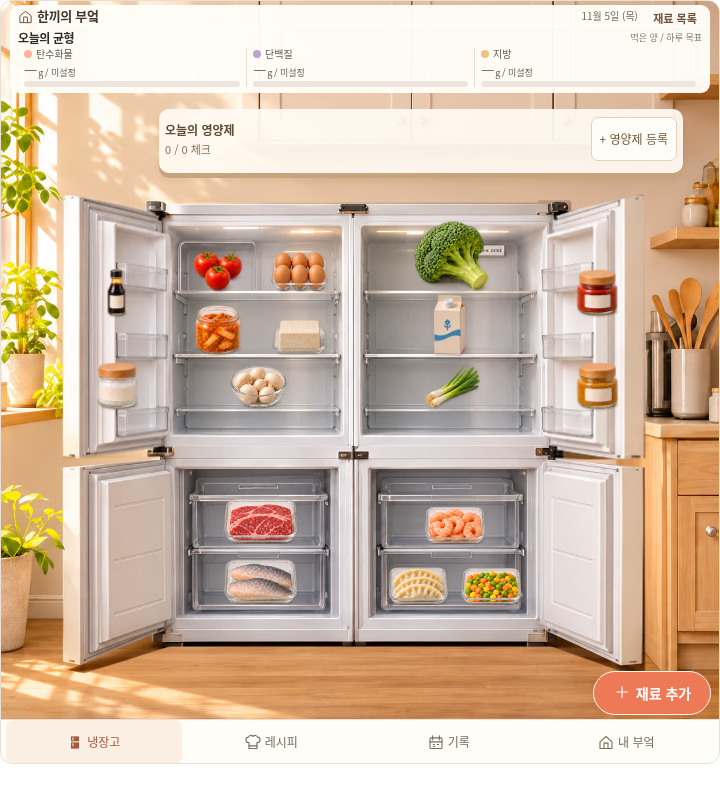
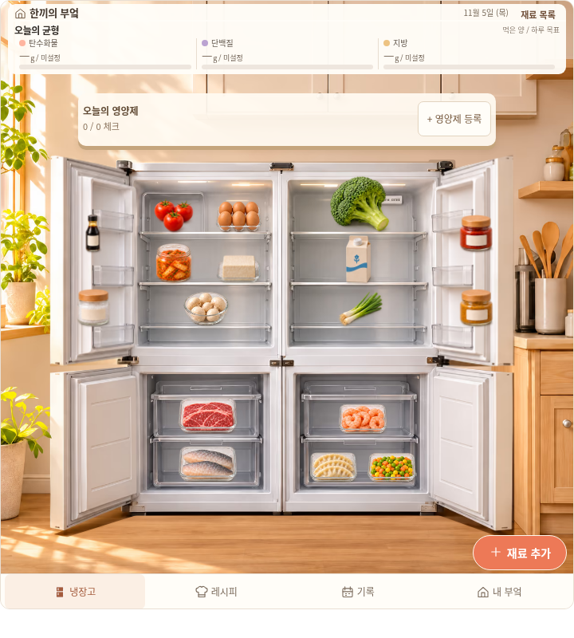

# 영양제 카드 중앙 정렬

사용자의 영양제 카드 정렬 요청을 `fix/kitchen-supplement-alignment-20261106`에서 수정한다. 기준은 닫힌 냉장고 비율을 수정한 `f63f308d6eefb9a34d1af908036a174d950f858b`다. 기존 부엌 사진·문·수납 좌표·영양제와 식사/지출 기록·운영 사이트는 보존한다.

## 확인한 원인과 구현

- 큰 카드의 좌우 위치가22%/5%로 달라720px 위젯에서 중심이61px 오른쪽으로 치우쳤다. `left:50%`와 본인 폭의 절반 이동으로 부엌 중심에 맞춘다. 카드 폭73%는 유지한다.
- 작은 위젯도110px/76px, 작은 앱은132px/88px 여백으로17px/22px 오른쪽에 치우쳤다. 작은 영양제 버튼도 같은 중심선을 사용하고 최소92px 폭·44px 높이를 유지한다.
- 제목과 관리 버튼 폭이 서로 달라 안쪽 제품 목록도 중앙에서 벗어났다. 같은92px 양끝 열과 가운데 유동 열로 제품 목록의 중심도 카드 중심에 맞춘다. 긴 이름은 기존처럼 줄여 표시하고 접근성 이름과 관리 화면에서 전체 제품명을 유지한다.
- 식사 영양이 입력되면 영양판이 높아져 큰 카드와1.45px만 떨어졌다. 실제 공간이 부족한 작은 폭에서는 가운데 버튼으로 같은 영양제 기록에 들어간다. 큰 카드는 실제 컨테이너680px부터 표시하고 위쪽116px에 두어 영양 요약과 본체 사이에 배치한다. 외곽 border가2px이므로 실제681/682px 화면 양쪽을 검사한다.
- 큰 앱의 기존 영양 헤더가 과도하게 확대돼 카드를66px 가렸다. 부엌 홈의 제목/영양판만 고정 읽기 크기로 조정한다. 앱의 다른 화면·본체 사진 배율·저장 자료는 바꾸지 않는다.
- 꾸미기 적용 후 방 화면(D6)에서는 위젯·앱 모두 영양제 카드를 숨겨 방 소품을 가리지 않는다. 좁은 앱의 건강상식 타이포그래피는 원래600px 조건을 유지한다.

제품 수정은 `home-living.css`에 한정한다. 기존 생활 화면 회귀의 경계 프로필도681/682로 바꾸고 기존 비율 단언은 유지한다. 새 정렬 회귀는 같은 자료·뷰포트의 실제 이전/이후 파일을 검사하며 소스 PNG만 보고 공유 파일의 정렬을 승인하지 않는다.

## 검증 범위

위젯 native/opaque의320·390·599·600·681·682·720px 및 가로800×높이600, 앱390·720·1024px에서 빈 상태와 명시적인6제품/긴 이름/식사 영양 입력 상태를 구분한다. 중앙선·제품 목록 중앙·44px 클릭·영양판/본체/브랜드와의 겹침·실제 복용 체크·관리/등록 이동·날짜 분리·기존 저장 자료를 검사한다.

시각 검토와 자동 검사, 로컬 Chromium과 공개 미리보기 실행·실제 Notion·Safari·휴대폰 검증을 구분한다. 운영 main과 금융 자동 갱신은 변경하지 않으며 병합·실제 배포를 진행하지 않는다.

## 최종 결과와 실제 화면

[실행 요약](kitchen-supplement-align-20261106/verification.json), [전체 검사 결과 gzip](kitchen-supplement-align-20261106/browser-results.json.gz), [고정 소스/출력 해시](kitchen-supplement-align-20261106/build-manifest.json)를 보존했다. 최종 `after-v1`에서 브라우저23사례·986단언과 전송12건이 통과했다. 새 검사는 위젯16·앱3의 빈/입력38화면과 기존 실제 날짜/등록4사례를 포함한다. 복용 체크·등록·다른 날짜·D6 숨김·복귀·재로딩을 실제 조작했다. native 저장과 opaque 임시 미리보기는 구분한다.

[전후 출처](kitchen-supplement-align-20261106/before-provenance.json)에서 기존4HTML과38PNG를 보존하고 빈 상태·입력 상태의 자료가19/19 정확히 같음을 확인했다. [기존 파일에 적용한 새 검사](kitchen-supplement-align-20261106/negative-control.json)는58개 실패로 이전 정렬/가림 문제를 검출한다. 이는 수정본 통과와 별도의 음성 대조다.

[정렬 실측](kitchen-supplement-align-20261106/spacing-summary.json)에서38카드의 중심 오차와 큰 카드의 제품 열 중심 오차는0px이다. 큰 카드와 영양판 사이 최소8.02px, 본체와 최소8.88px를 확인했다. [수동 검토](kitchen-supplement-align-20261106/manual-review.json)와 [독립 수동 검토](kitchen-supplement-align-20261106/independent-review.json)는 원본 소스 사진이 아니라 실제 compact HTML을 실행한 화면을 직접 본 범위다. 자동 통과를 사용자 디자인 승인으로 취급하지 않는다.

| 같은 자료·720×800 실제 위젯 | 수정 전 | 수정 후 |
| --- | --- | --- |
| 영양제 카드 |  |  |

[6제품·긴 이름](kitchen-supplement-align-20261106/after-products-720.png), [320px](kitchen-supplement-align-20261106/after-products-320.png), [681px 작은 버튼](kitchen-supplement-align-20261106/after-compact-681.png), [682px 큰 카드](kitchen-supplement-align-20261106/after-wide-682.png), [앱 이전](kitchen-supplement-align-20261106/before-app-720.png), [앱 이후](kitchen-supplement-align-20261106/after-app-720.png)도 실제 캡처다. 제품·영양·식비가 있는 사진은 명시적 격리 QA 입력이다. 해당 값을 제품 기본 데이터에 추가하지 않았다.

생성4HTML은1,023,062–1,024,461B로 모두1MiB 이내이며, 검사를 마친 고정 파일과 `previews/`의 바이트가 같다. 빌드 입력103개 중 `home-living.css`만 달라졌고 JavaScript·사진·모델·데이터는 그대로다. 별도 [보존 기록](kitchen-supplement-align-20261106/preservation.json)에 기존 자료·자동화·운영 진입점의 변경 여부를 남겼다. 이전 냉장고 비율 검사의 Node233건·브라우저14사례 전체를 이번에 다시 실행한 것으로 보고하지 않는다.

```bash
python scripts/test_kitchen_supplement_alignment_browser.py \
  --root /tmp/kitchen-frozen --output /tmp/kitchen-supplement-qa \
  --browser-executable /usr/bin/chromium
```

전체 원시 PNG·로그와 첫 소스 탐색은 체크아웃 밖 `/workspace/.notion-cloud/kitchen-supplement-align-20261106/`에 보존했다. 실제 Notion·Safari·휴대폰은 미검증이다. 공개 HTMLPreview와 GitHub API는 이 환경에서403이므로 원본 파일의 HTTP 접근·로컬 opaque 실행과 공개 사이트 실행/PR 생성 결과를 구분한다. 자동 병합·운영 배포는 진행하지 않는다.
