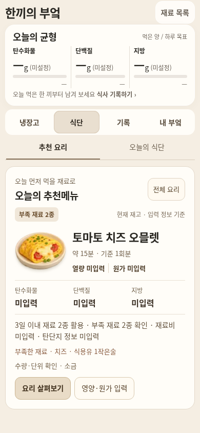
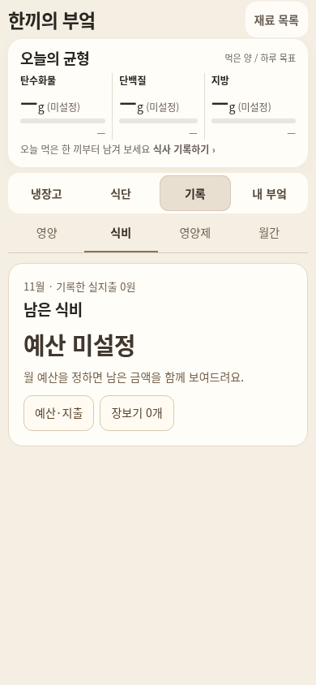
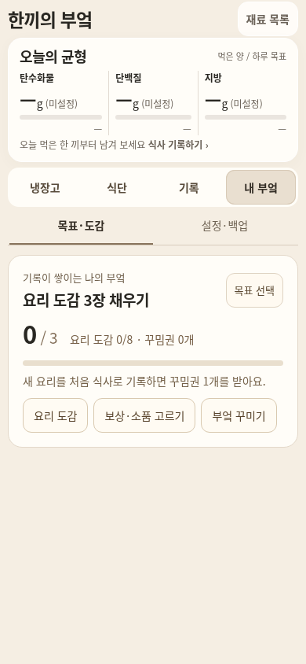

# 한끼의 부엌 · 양념과 작업별 탭

기준일 2026-11-01 Asia/Seoul. 사용자 요청은 양념 이름표도 조용하게 만들고, 디자인 문제를 찾아 긴 스크롤을 탭으로 바꾸는 것이다. 기존 흰색 4도어 미니어처·아이보리 햇살·그림 자산을 유지한다.

## 확인한 문제와 수정

| 확인한 문제 | 실제 수정 |
| --- | --- |
| 양념 선반에서 이름·수량 badge와 item-label이 겹친다. 문 안쪽 이름 배경도 CSS 우선순위 때문에 흰색이 남는다. | 이미지에 인쇄된 글씨가 아니라 중복 DOM이었다. 병당 `.sauce-label` 하나로 합치고 9.5/8.5px·weight400·배경/그림자 없는 주석으로 표시한다. 선택한 한 개만 10.5/9.5px의 밝은 표면을 쓴다. 기한은 aria와 native 선택 요약/상세에 유지한다. |
| 상단은 스크롤/모달 바로가기, 하단은 또 다른 메뉴여서 탐색 의미가 섞인다. | 상단의 실제 탭 하나를 냉장고/식단/기록/내 부엌으로 통일한다. 하단은 냉장고에서 재료 추가·요리 찾기 두 행동만 둔다. |
| 추천·계획·예산·영양제·월간·목표·사진 설명이 모두 세로로 쌓여 페이지가 약 3,000px가 된다. | 선택한 화면 하나만 표시한다. 추천/계획, 영양/식비/영양제/월간, 목표·도감/설정·백업의 8개 하위 보기를 제공한다. 긴 제품 목록과 상세 입력만 내부 스크롤한다. |
| 목표와 추천 정보가 반복되어 냉장고보다 강하다. | 냉장고 아래 반복 목표를 없애고 내 부엌으로 옮긴다. 선택 정보와 재료 목록 진입을 남긴다. PC 요리 요약은 넓은 공간에서만 유지한다. |
| 낮은 임베드에서 UI를 모두 쌓으면 냉장고를 과도하게 축소하게 된다. | 높이 760px 이하에서 영양 요약의 여백과 반복 안내를 줄인다. 탄수화물·단백질·지방 현재값(목표값), 상태는 유지한다. 임시 세션/저장 중단과 백업은 44px 조작을 갖춘 헤더 표시로 옮겨 별도 안내 행이 장면을 줄이지 않게 한다. 360px 이하·높이760px 이하에서는 기본 재료 주석에 이름만 두고 수량은 선택한 주석과 14px 선택 요약/상세에서 본다. 장면은 남은 높이에 맞추며 원래 비율을 유지한다. |

화면을 바꾸는 작업은 재료 데이터를 쓰지 않는다. 선택한 하위 탭을 유지하며, 키보드 방향키/Home/End·44px 탭·하나의 tabpanel·대화상자 초점 복귀를 제공한다. 요리 선택·재료 저장·꾸미기로 장면에 돌아올 때 숨겨진 냉장고 탭을 먼저 열고, 숨겨진 장면의 폭0으로 배경/문/라벨을 재계산하지 않는다.

## 경로와 데이터

공통 원본 `designs/miniature-kitchen/scene.html`, `home.js`, `proportions.css`, `journey.css`, `neutral.css`, `scene.js`, 선택 안내 문구의 `workflows.js` 및 생성된 `previews/`만 UI 범위로 수정한다. 모델 계산·이미지 원본·운영 진입점은 바꾸지 않는다. `miniature-kitchen-preview-v1`, envelope version1, 실제 수량·기한·개봉일·좌표·층·문·식사/취소/영양/식비 기록을 유지한다.

제품/기한 2장 OCR과 검수·수동 입력은 기존 경로를 유지한다. 냉장고 전체 물체 자동 탐지·새 미니어처 생성·공식 영양/가격·개인별 권장량·기기 간 동기화는 이번 UI 작업으로 구현된 기능이 아니다. 영양/원가 미입력을 0으로 계산하거나 임시 세션을 영구 저장으로 표시하지 않는다.

## 검증과 증거

최종 UI 소스는 `6a02899fdbdec9cc46d92bc750864c78a6f37e3d`다. 후속 문서·근거·회귀 체크 보강 커밋은 이 생성 HTML을 바꾸지 않는다. 검증에는 별도 시안의 예시 재료와 테스트용 수동 기록을 사용했다.

| 검사 | 실제 결과와 근거 |
| --- | --- |
| 생성·전송 | 앱1,020,863B / 위젯1,020,866B, 모바일 wrapper1,046,358B / 1,046,367B로 각1MiB 이내다. [바이트·SHA256](kitchen-tabs/generated-files.json). 같은8개 인코딩 이미지 바이트와 원본 자산을 유지했고, 사용하지 않는 숨긴 목표 스타일만 정리했다. 전송 단위검사2/2 통과. |
| 기능·저장 | **82/82 통과**, JS예외0. 기존 냉장고27 + 가독성23 + 식단/재고/예산/복구 실제 흐름22 + 새 탭10이다. [요약](kitchen-tabs/summary.json), [흐름](kitchen-tabs/journey-results.json), [가독성](kitchen-tabs/readability-results.json), [회귀](kitchen-tabs/regression-results.json), [탭](kitchen-tabs/tabs-results.json). 최종 생성물4개의 해시가 검사 입력과 일치한다. |
| 탭·긴 목록 | 4개 동일폭44px 탭·단일 패널·8개 하위 보기·방향키/Home/End·모달 초점 복귀·숨긴 장면에서 조리대 복귀를 실제 조작했다. 영양제16개를 실제 form으로 등록해 탭 내부 스크롤로 끝까지 체크하고 기록과 초점을 확인했다. 탭만 오간 경우 원본 envelope가 완전히 같다. |
| 작은 화면 | 앱/위젯×320/390×일반/opaque **8/8** 추가 사전 검사: 헤더 제목/상태/백업/재료 목록 겹침0, 320px 실제 이름 glyph 겹침0, 문서 스크롤0. [측정](kitchen-tabs/compact-preflight.json). 100,000g 수치도 칸 안에 줄바꿈되어 기존 경계 검사를 통과했다. 작은 화면의 주요 영양값20px·상세14px·입력16px를 유지한다. |
| 같은 상태 전후 | 앱/위젯390·1120 **4개**, 같은 envelope/Nov1/문4개 열림/선택 없음. 원본 데이터가 같고 원래 가로세로 비율·중앙 배치를 유지한다. 앱390 페이지3062→844px, 위젯390 3059→844px, 넓은 화면2539/2937→1000px다. 가로 넘침/하단 작업 영역과 냉장고 겹침0. [비교](kitchen-tabs/comparison.json), [변경 전 manifest](kitchen-tabs/before-manifest.json), [후](kitchen-tabs/after-manifest.json). |
| 크기 차이 | 새 카메라 탭을 계속 보이게 하므로 native390 장면은370→336.72px로 약9% 줄고, 넓은 화면도 약8% 줄었다. 그림의 native 크기가 그대로라는 주장은 하지 않는다. 최종 opaque320에서는 저장 안내를 헤더로 옮겨 장면237.31px·본체227.61px 높이를 확보하며 native와 같은 공간을 사용한다. 냉장고 구도·배경 설치선도 화면에서 확인했다. |
| 실제 공개 HTTPS | 앱/위젯×649×900·390×844·320×660 **6/6**, 정상 원본CDN OCR **2/2** 통과. HTTP200·원문SHA256 일치·JS0·실제 터치/문/양념·탭·예산·식단·사진 검수 흐름을 확인했다. [최종 공개 결과](kitchen-tabs/public-results.json), [실행](https://github.com/Ohoredingdong/Notion/actions/runs/41317446189). 이전 후보 결과를 최종 소스 결과로 재사용하지 않았다. |

공개 검토는 기존 운영과 별도 시안이며 opaque iframe에서 임시 세션이다. 화면을 닫기 전에 헤더 백업으로 보관한다. 물리 휴대폰·Safari·실제 Notion 검증과 브라우저의 모바일 크기 검사를 구별한다. main과 Pages 설정은 변경하지 않았다.

## 실제 화면

같은 데이터·문·뷰포트의 [변경 전](kitchen-tabs/app-390-before.png) / [변경 후](kitchen-tabs/app-390-after.png). [PC](kitchen-tabs/app-1120-after.png) · [위젯](kitchen-tabs/widget-390-after.png) · [320px 공개 프레임](kitchen-tabs/app-320-opaque.png).

| 추천 요리 탭 | 식비 탭 | 목표·도감 탭 |
| --- | --- | --- |
|  |  |  |

양념 비교는 같은 재료를 선반으로 옮긴 상태다. [중복 배지 이전](kitchen-tabs/sauces-before.png) / [단일 주석 이후](kitchen-tabs/sauces-after.png). 사진으로 제품을 새로 인식하거나 생성한 결과로 제시하는 이미지가 아니다.

## 공개 확인과 반영 상태

- [앱 열기](https://htmlpreview.github.io/?https://raw.githubusercontent.com/Ohoredingdong/Notion/6a02899fdbdec9cc46d92bc750864c78a6f37e3d/previews/mobile/app.html)
- [위젯 열기](https://htmlpreview.github.io/?https://raw.githubusercontent.com/Ohoredingdong/Notion/6a02899fdbdec9cc46d92bc750864c78a6f37e3d/previews/mobile/widget.html)

`feat/kitchen-tab-navigation`에 push했다. base `fix/kitchen-subtle-labels`로 PR 생성 시도는 GitHub GraphQL API403 Forbidden으로 실패했다. [PR 비교/작성](https://github.com/Ohoredingdong/Notion/compare/fix/kitchen-subtle-labels...feat/kitchen-tab-navigation?expand=1).

검증용 CI는 `delivery/verify-kitchen-tabs-20261101`, 합성 결과는 `preview/kitchen-tabs-validation-20261101`에만 게시했다. 최종 검증 source는 위6a02899f이며, 최초 후보 ed548539의 결과는 별도로 보존했다. main·Pages 설정·운영 진입점과 운영 데이터를 바꾸지 않았다.
