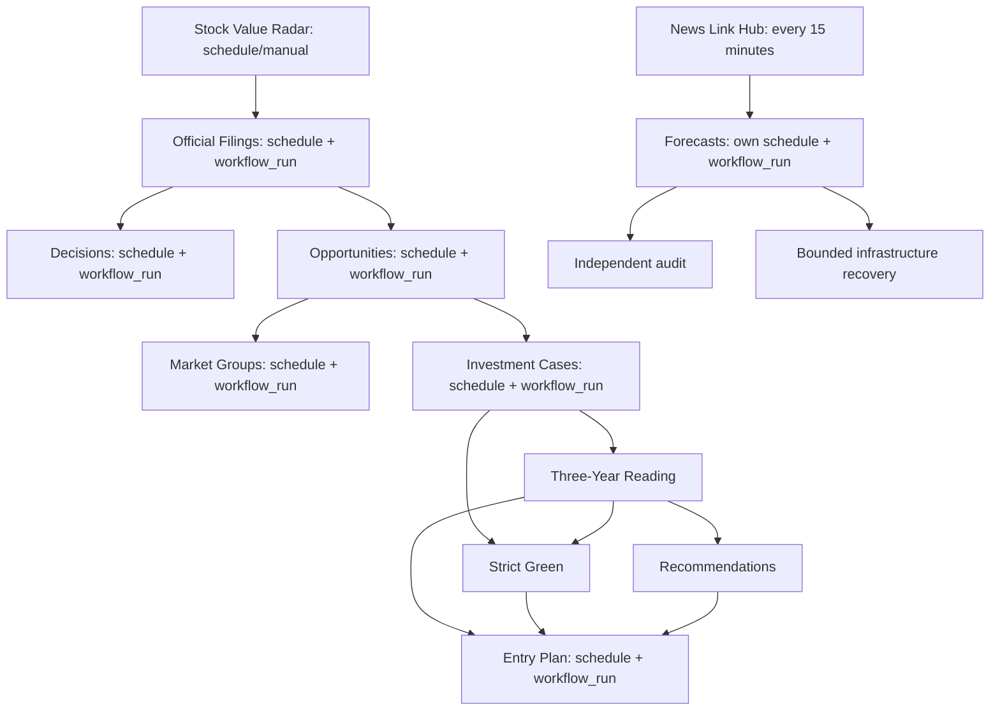

# 개발 자동화 감사 — 2026-11-05

이 문서는 `Ohoredingdong/Notion`의 감사 시작 시점 원본을 기록합니다. 기준은 Git revision `17d11d28fdf156f7a6f9ee7eeefe689e761cd83c`이며, 이후 이 PR에서 변경한 설정의 결과나 GitHub Actions 통과를 뜻하지 않습니다. 최초 로컬 checkout `5f2e287d`는 원격 main보다 121 commits 뒤에 있었습니다. 원격 main을 확인하고 최신 revision을 다시 조사했습니다. 36개라는 초기 집계는 폐기하고 **38개**를 기준으로 삼습니다.

전체 trigger/path/cron/권한/job guard/checkout/publication 명령과 원본 SHA-256은 [기계 판독 inventory](development-workflow-inventory.json)에 있습니다. 기존 운영 데이터나 workflow를 이 감사 과정에서 실행·삭제·초기화하지 않았습니다.

## 확인 범위와 한계

| 대상 | 확인 결과 |
| --- | --- |
| 소스·workflow·publisher | 위 revision의 Git 원본을 전수 조사 |
| 브랜치 | native Git 조회에서 remote heads 174개 확인; `main` 외 과거 design/fix/research trigger가 있음 |
| GitHub Actions 성공/실패 이력 | GitHub API 403으로 미확인; 소스 불일치를 실제 원격 실패라고 단정하지 않음 |
| Pages source branch / Actions 방식 | API 403으로 미확인; 저장소에 `deploy-pages`, `configure-pages`, `upload-pages-artifact` 없음 |
| branch protection / rulesets / required checks | API 403으로 미확인; 수정하지 않음 |
| 현재 운영 화면·실제 Notion 앱 | 이 소스 감사만으로 검증되지 않음; 브라우저 결과 보고와 구분 |
| secrets / 외부 API·금융 원천 접속 | 값 조회·노출 없음; 운영 수집기를 감사용으로 실행하지 않음 |

`.nojekyll`, 공개 `github.io` 주소, 세 workflow의 `POST repos/.../pages/builds` 호출은 branch Pages 사용 가능성을 보여 줍니다. **실제 Pages source가 main인지 다른 branch인지, Actions인지 아직 확정할 수 없습니다.** 따라서 이 문서만으로 배포가 보호되었다고 보고할 수 없습니다.

## 38개 workflow 전수 목록

M=수동 실행, P=push, S=정기 실행, W=workflow_run, R=pull_request. 권한 W/R은 `contents: write/read`이며 이슈/Actions/Pages 추가 권한은 JSON 원본을 참조합니다. 아래 검사는 해당 workflow에 작성되어 있다는 뜻이며 이번 작업에서 실행에 성공했다는 뜻이 아닙니다.

| Workflow | Trigger | 권한 | 게시/변경 대상 | 작성된 검사 | 감사 사항 |
| --- | --- | --- | --- | --- | --- |
| [audit-stock-radar-accuracy.yml](../.github/workflows/audit-stock-radar-accuracy.yml) — Audit Stock Radar Accuracy | M/P/S | W | 정확도 감사 JSON | 감사 재계산·무결성 검사 | 데이터 main push + 정기 감사; PR 검사 없음 |
| [monitor-stock-value-radar.yml](../.github/workflows/monitor-stock-value-radar.yml) — Monitor Stock Radar Health | M/P/S | W | health JSON + 경고 이슈 | 시각·커버리지·원천·이상값 | 알림/건강 상태 기록; 배포 차단 기능 없음 |
| [probe-decision-sources.yml](../.github/workflows/probe-decision-sources.yml) — Probe Decision Sources | M/P | R | 없음 | 외부 데이터 소스 접근 진단 | 수동/해당 스크립트 main push만 실행 |
| [stock-autopilot-recovery.yml](../.github/workflows/stock-autopilot-recovery.yml) — Stock Autopilot Bounded Recovery | W | R | 실패 job 1회 재실행 요청 | 인프라 오류 allowlist·첫 시도·동일 저장소 | 정상 결과를 대신하지 않는 복구 장치 |
| [stock-entry-plan.yml](../.github/workflows/stock-entry-plan.yml) — Stock Entry Plan | M/P/S/W | W | 진입계획 JSON/JSONL + Pages build 요청 | Python 정책·JS UI·브라우저·공개 snapshot | main 재취득 뒤 결과 재생성; main 직접 push 필요 |
| [stock-forecast-independent-audit.yml](../.github/workflows/stock-forecast-independent-audit.yml) — Independent Forecast Evidence Audit | M/P/S/W/R | R | artifact/summary만 | 출처·원장·시점·학습·수용 조건 독립 감사 | 현재 PR 범위는 지정된 forecast 파일에 한정 |
| [stock-forecasts.yml](../.github/workflows/stock-forecasts.yml) — Stock Prospective Forecasts | M/P/S/W | W | forecast JSON/JSONL + HTML 태그 + Pages build | 모델/학습/방향/복구 unit·JS·실제 브라우저·공개 검증 | 뉴스 완료 후 성공 guard·시간 gate 있음; 큐에 쌓일 수 있음 |
| [stock-investment-cases.yml](../.github/workflows/stock-investment-cases.yml) — Stock Investment Cases | M/P/S/W | W | cases/green/macro/guide JSON + legacy UI | 사례·macro·guide·strict unit·원문 검사 | workflow_run 선행 실패 guard 없음; source→UI 두 번 push 가능 |
| [stock-reading-depth.yml](../.github/workflows/stock-reading-depth.yml) — Stock Three-Year Reading | M/P/W | W | 3개년 reading JSON | 기간·평균자본 ROE unit | workflow_run 선행 실패 guard 없음 |
| [stock-recommendations.yml](../.github/workflows/stock-recommendations.yml) — Stock Recommendations | M/P/W | W | 이벤트·추천 JSON | 추천 정책 unit·JS syntax | 성공 guard 있음; 별도 PR 경로 없음 |
| [stock-strict-green.yml](../.github/workflows/stock-strict-green.yml) — Strict Green Review | M/P/W | W | cases/green JSON + legacy UI | 누락·오래됨·충돌·unsafe-positive unit | 성공 guard 있음; cases/reading 양쪽 완료로 중복 가능 |
| [test-stock-decisions-ui.yml](../.github/workflows/test-stock-decisions-ui.yml) — Test Stock Decision UI | M/P/W | R | artifact만 | decision 실제 브라우저·레이아웃·오류 상태 | 구형 neutral selector가 현재 flow 페이지와 불일치; 실행 확인 별도 |
| [test-stock-neutral-ui.yml](../.github/workflows/test-stock-neutral-ui.yml) — Verify Neutral Production Radar | M/P/S | W | schedule: chart JSON + Pages build; design: UI | installer idempotency·데이터 hash·브라우저·공개 hash | 검사 job은 구형 neutral UI 주입; schedule은 현행 차트 갱신 |
| [test-stock-radar-canonical.yml](../.github/workflows/test-stock-radar-canonical.yml) — Verify Canonical Stock Radar Layout | M/P/R | R | 없음 | 두 진입 URL·canonical 패널 경계 실제 브라우저 | PR 감시 있음; push paths에는 JS 2개가 누락 |
| [test-stock-radar-integration.yml](../.github/workflows/test-stock-radar-integration.yml) — Test Stock Radar Integrated UI | M/P/R | R | artifact만 | 보호·정확도·macro·entry·decision·flow 브라우저 | PR paths가 push보다 좁음; flow/decision 구형 기대값 존재 |
| [test-stock-radar-ui-preview.yml](../.github/workflows/test-stock-radar-ui-preview.yml) — Verify Comparison Desk UI Preview | M/P | W | design branch만 preview HTML | 별도 preview 생성/idempotency·브라우저·공개 hash | 의도적 demo preview; 현행 운영 radar 검사 대체 불가 |
| [test-toss-live.yml](../.github/workflows/test-toss-live.yml) — Test Toss Read-Only Live Adapter | M/P | R | 없음 | synthetic frame adapter unit·Python/JS compile | 프레임 fixture는 unit용; 실제 Toss 접속 성공 증거 아님 |
| [update-bond-yields.yml](../.github/workflows/update-bond-yields.yml) — Update Bond Yields | M/P/S | W | bond JSON | 수집기 실행·JSON 파싱 publisher | 수집기 단위 회귀가 Actions에 없음 |
| [update-commodities.yml](../.github/workflows/update-commodities.yml) — Update commodities data | M/P/S | W | commodities JSON | 수집기 실행·JSON 파싱 publisher | 수집기 단위 회귀가 Actions에 없음 |
| [update-cryptocurrency.yml](../.github/workflows/update-cryptocurrency.yml) — Update Cryptocurrency Dashboard | M/P/S | W | crypto·Korea-premium JSON | 수집기 실행·JSON 파싱 publisher | 공통 parser 변경으로 여러 위젯 영향; PR 경로 없음 |
| [update-exchange-rates.yml](../.github/workflows/update-exchange-rates.yml) — Update Exchange Rates | M/P/S | W | FX JSON | 수집기 실행·JSON 파싱 publisher | 공통 publisher 변경은 자체 path trigger에 없음 |
| [update-fear-greed.yml](../.github/workflows/update-fear-greed.yml) — Update Market Sentiment Data | M/P/S | W | US/Korea/crypto sentiment JSON | 수집기 실행·JSON 파싱 publisher | Korea radar 전용 snapshot과 다른 데이터·주기 |
| [update-korea-fear-greed.yml](../.github/workflows/update-korea-fear-greed.yml) — Update Korea Fear Greed | M/P/S | W | radar Korea sentiment JSON | Python compile·공식 API 수집 | main rebase push; 일반 sentiment와 함부로 통합 금지 |
| [update-market-events.yml](../.github/workflows/update-market-events.yml) — Update Market Events | M/P/S/R | W | market-events/outlook JSON | 이벤트 시점·가짜 매매신호 unit·UI 검사 | PR은 네트워크 수집·publish 제외; 권한은 workflow write |
| [update-mortgage-rates.yml](../.github/workflows/update-mortgage-rates.yml) — Update Mortgage Reference Rates | M/P/S | W | mortgage JSON + 수집 health | 공식 발표 수집·JSON publisher | 수집 실패 후 health 기록, 마지막 exit 1로 실패 유지 |
| [update-news-link-hub.yml](../.github/workflows/update-news-link-hub.yml) — Update News Link Hub | M/P/S | W | news JSON | RSS 수집·JSON publisher | 15분 주기; forecast workflow_run의 기점 |
| [update-real-estate-pulse.yml](../.github/workflows/update-real-estate-pulse.yml) — Update Real Estate Pulse | M/P/S | W | REB dataset/health JSON | 공식 REB 수집·JSON publisher | 실패 후 health 기록·exit 1; 과거 fix branch에서도 main publisher 가능 |
| [update-stock-decisions.yml](../.github/workflows/update-stock-decisions.yml) — Update Stock Decisions | M/P/S/W | W | decision JSON + legacy stock-decision-v7.js | 숫자·시장시계 unit·JS syntax | workflow_run 선행 실패 guard 없음 |
| [update-stock-market-groups.yml](../.github/workflows/update-stock-market-groups.yml) — Update Stock Market Groups | M/P/S/W | W | classification JSON + legacy UI/installer | 상장·소속 unit·JS syntax | 성공 guard 있음; 데이터 외 코드도 생성 |
| [update-stock-opportunities.yml](../.github/workflows/update-stock-opportunities.yml) — Update Stock Opportunities | M/P/S/W | W | opportunity JSON + legacy UI/installer | 위험·공시·날짜·발굴 unit·JS syntax | workflow_run 선행 실패 guard 없음; cancel-in-progress=true |
| [update-stock-value-radar.yml](../.github/workflows/update-stock-value-radar.yml) — Update Stock Value Radar | M/P/S | W | raw/intelligence/history JSON + report MD | output 회사 수·quality/thesis 검사 | main rebase 직접 push; 기존 금융 갱신의 기점 |
| [update-stocks-dashboard.yml](../.github/workflows/update-stocks-dashboard.yml) — Update Stocks Dashboard | M/P/S | W | stocks·market-radar JSON | 수집기 실행·JSON 파싱 publisher | 공통 parser 영향; PR 경로 없음 |
| [update-supply-chain.yml](../.github/workflows/update-supply-chain.yml) — Update Supply Chain Pulse | M/P/S | W | supply-chain JSON | 수집기 실행·JSON 파싱 publisher | 수집기 단위 회귀가 Actions에 없음 |
| [validate-real-estate-pulse.yml](../.github/workflows/validate-real-estate-pulse.yml) — Validate Real Estate Pulse | R | R | 없음 | 16지역/32수치·공식출처·SHA256·BOK 출처 | PR은 dataset/workflow 두 경로만 감시 |
| [verify-investment-embeds.yml](../.github/workflows/verify-investment-embeds.yml) — Verify investment widget embeds | M/P | R | 없음 | 공개 9개 파일 고정 hash·문법·iframe header | checkout 없는 live 검사; 변경 PR 원본을 검증하지 않음 |
| [verify-stock-detail-v6.yml](../.github/workflows/verify-stock-detail-v6.yml) — Verify Stock Detail V6 | M/P | R | artifact만 | JS syntax·evidence/forecast wiring·detail 브라우저 | main push 전용; PR 검사 없음 |
| [verify-stock-official.yml](../.github/workflows/verify-stock-official.yml) — Verify Stock Official Filings | M/P/S/W | W | audit/history/test JSON + 경고 이슈 | 기간·법인·단위·정의 unit·원문 대조 | workflow_run 선행 실패 guard 없음 |
| [verify-stock-value-radar.yml](../.github/workflows/verify-stock-value-radar.yml) — Verify Stock Value Radar | M/P | R | 없음 | 부정값·UI 구조·출처/시각·JS syntax | main push 전용; 실제 브라우저 아님 |


집계: 38 workflows / schedule 24 / push 36 / PR 5 / workflow_run 13 / contents write 27 / read 11. 정기 갱신과 테스트가 같은 workflow에 함께 있는 경우가 있어 파일 이름만 보고 테스트 중복으로 삭제하면 안 됩니다.

## 실제 게시 경로와 데이터 보존

- `publish_widget_data.py`는 명시한 상대 `.json` 파일만 허용하고 JSON 파싱·경로·symlink를 검사합니다. 최신 `origin/main`의 별도 worktree에 쓰고 정상 fast-forward push만 수행합니다. 다른 job이 더 최신 timestamp를 게시했으면 전체 현재 bundle을 보존합니다. 비교할 timestamp가 없는 동시 변경은 실패합니다. 이 경로는 비교적 안전하며 공통 publisher 변경은 모든 호출자의 검사가 필요합니다.
- `publish_stock_opportunities.py`는 8개 opportunity JSON 외에 `assets/stock-radar-v8.{js,css,html}`, `scripts/install_stock_decision_ui.py`, `scripts/install_stock_audit_ui.py`도 stage합니다. 최신 main에서 생성기를 실행하고, 수집 engine digest가 바뀌면 수집을 다시 요구합니다. 현재 custom homepage는 stage 목록에 없습니다.
- `publish_stock_market_groups.py`는 분류 JSON 외에 legacy v8/v9 JS·v8 HTML·installer 두 개를 stage합니다. `publish_stock_investment_cases.py`도 legacy v8 HTML/JS·v9 JS·cases/recommendations JS·installer 두 개를 stage합니다. 둘 모두 최신 main worktree를 사용하지만 **JSON만 갱신하는 작업이 아닙니다.**
- `publish_stock_forecasts.py`는 forecast/learning/autopilot JSON·JSONL과 함께 `stock-value-radar.html`, `assets/stock-radar-v8.html`, `stock-forecast.html`에 forecast runtime 태그를 누락 시 추가합니다. immutable ledger ID 충돌, 더 최신 forecast, learning-state CAS 충돌은 거부합니다. 현재 홈페이지의 기존 forecast 태그는 보존해야 합니다.
- `update-stock-value-radar.yml`은 raw/intelligence/history JSON·보고서 MD를, `update-stock-decisions.yml`은 decision JSON과 legacy JS를, health/accuracy/Korea-sentiment workflow는 개별 JSON을 main에 rebase push합니다. 무차별 `git add .`는 발견되지 않았습니다. 그러나 일부 publisher는 운영 코드도 stage하므로 모든 bot에 blanket JSON-only 정책을 적용하면 기존 기능이 중단됩니다.
- `stock-entry-plan.yml`과 neutral schedule job의 `git reset --hard origin/main`은 일회용 Actions checkout에서 최신 데이터를 기준으로 재생성하기 위한 것입니다. 사용자 로컬 checkout의 변경을 초기화하는 개발 절차로 복사하면 안 됩니다.
- mortgage/REB workflow의 `continue-on-error`는 수집 상태를 게시할 기회를 남긴 뒤 마지막 `exit 1`로 실패를 유지합니다. 가짜 성공 처리가 아니므로 없애면 장애 health 기록이 사라질 수 있습니다.

기존 `test_stock_radar_publish_protection.py`는 legacy publisher 세 개와 decision workflow의 custom 홈페이지 stage 방지를 확인합니다. forecast publisher의 HTML 태그 관리나 다른 임의 publisher까지 검사하는 일반적인 파일 보존 보증은 아닙니다.

## 중복·노후화·누락된 검증

### 해결이 필요한 소스 불일치

- `test_stock_radar_flow_browser.py`는 runtime script가 정확히 두 개라고 요구하고 구형 `.fx-v5-sentiment` selector를 사용합니다. 현재 flow 페이지에는 forecast runtime 네 개가 더 있고 sentiment v9 구조를 사용합니다. 검사 대상을 필수 runtime 존재·중복 금지·현재 sentiment 동작으로 갱신해야 합니다. 기존 runtime 삭제로 검사에 맞추면 기능이 손상됩니다.
- `test_stock_decision_browser.py`의 legacy 화면 검사는 `#nr-market-overview,#nr-home-alerts,#nr-home-picks`라는 구형 neutral 홈 구성을 요구합니다. 현행 flow 홈과 보관된 advanced 페이지의 역할을 구분하여 올바른 화면의 동작을 검사해야 합니다.
- `test-stock-neutral-ui.yml`의 verify job은 neutral CSS/JS를 운영 HTML에 주입한 뒤 원본과 diff가 없기를 요구합니다. 현행 custom flow homepage를 검증하는 절차로는 부적절합니다. **동일 파일의 schedule job은 실제 chart cache를 갱신하므로 보존해야 합니다.** 과거 design branch 기능도 임의 삭제하지 않습니다.
- `verify-investment-embeds.yml`은 checkout 없이 공개 파일 9개의 고정 SHA-256을 검사합니다. 제안된 PR 코드가 아니라 이미 공개된 과거 결과만 확인합니다. 이후 합당한 파일 변경도 hash 갱신 전에는 실패합니다. 후보 checkout으로 expected hash를 만들고 공개 검증은 배포 후 검사로 분리하는 방식이 필요합니다.

위 항목은 기준 revision의 소스에서 확인한 문제입니다. 실제 실행 상태·해당 수정 후 통과 여부는 이번 PR의 테스트 보고서로 별도 기록해야 합니다.

### 최신 main에서 이미 추가된 검사

초기 로컬 checkout에는 없었지만 감사 기준 revision에는 `test-stock-radar-canonical.yml`, `verify-stock-detail-v6.yml`, 이벤트 outlook unit/UI 검사와 PR trigger가 있습니다. 이를 다시 만들거나 이전 저장소 상태로 되돌리면 안 됩니다. canonical 검사는 진입 URL·레이아웃 경계를, detail 검사는 evidence/forecast wiring과 상세 화면을 다루므로 통합 브라우저 검사와 범위가 일부 달라도 단순 중복은 아닙니다.

현재 5개 workflow만 PR trigger를 가집니다. integration의 PR path 목록은 push 목록보다 좁고, canonical의 push path에는 bridge/flow JS가 빠져 있습니다. 공통 publisher·parser 변경이 여러 수집 workflow에 영향을 줘도 각자의 `push.paths`가 공유 파일을 모두 감시하지 않습니다. 냉장고의 domain/store/kitchen/UI Node 테스트는 존재하지만 기존 Actions에서 실행하는 workflow는 없습니다. 그 밖의 정적 위젯도 모두를 포괄하는 공통 syntax·상대 asset 경로·브라우저 검사가 없습니다.

### 중복 실행이 생기는 구조



정기 실행과 upstream 완료에 의한 실행이 겹칠 수 있습니다. 특히 strict review와 entry는 여러 선행 workflow 완료를 받습니다. GitHub `workflow_run` 연쇄는 세 단계까지만 지원하므로 위 전체 경로가 최초 수집 한 번에서 끝까지 실행된다고 가정할 수 없습니다. 각자의 schedule/manual 기점은 복구 역할도 합니다. 이번 개선에서 주기·workflow 이름·데이터 파일·동시 실행 의미를 임의로 통합하거나 제거하지 않습니다.

기준 revision의 `verify-stock-official`, `update-stock-decisions`, `update-stock-opportunities`, `stock-investment-cases`, `stock-reading-depth` job은 선행 workflow 실패에도 `workflow_run: completed`만으로 실행됩니다. read-only `test-stock-decisions-ui`도 동일합니다. 실패한 원천의 기존 snapshot으로 후속 결과를 게시할 수 있으므로 게시하는 job에는 아래와 같이 **workflow_run만 성공 여부를 제한**하는 guard를 권합니다. 수동·push·schedule은 그대로 실행됩니다.

```yaml
if: github.event_name != 'workflow_run' || github.event.workflow_run.conclusion == 'success'
```

forecast 연구·market groups·recommendations·strict·entry에는 이미 이 형태가 있습니다. independent audit와 bounded recovery의 더 엄격한 repository/provenance 조건은 유지해야 합니다.

## 수정 파일에 따른 자동 검사 설계

| 수정 범위 | 필요한 후보 코드 검사 |
| --- | --- |
| 모든 변경 | workflow YAML·경로·정적 자산·Python/JS syntax 중 관련 파일 검사; 변경 경로를 fail closed로 분류 |
| 현행 radar HTML/bridge/flow·공유 radar CSS/JS | 현재 canonical + 상세/evidence/wiring + entry + flow 브라우저, desktop/mobile/iframe 화면, 전후 screenshot |
| forecast/model/learning/autopilot | 해당 unit·independent chronology/evidence self-tests·forecast UI/wiring; 운영 수집·학습 원장은 개발 검사에서 수정하지 않기 |
| 금융 수집기·공통 `market_data_utils.py` | parser/repair/market-context 부정 사례 + 관련 현재 데이터 schema/provenance; 외부 source 실패를 fixture 성공과 혼동하지 않기 |
| publisher·installer·Actions | 경로 허용목록/보존/경쟁 업데이트 검사, workflow syntax/guard 검사, 영향받는 radar browser; 실제 main push는 금지 |
| 냉장고 assets/HTML/tests | 기존 domain/store/kitchen/UI 테스트 + 관련 실제 브라우저; localStorage 스키마/기존 값 유지 |
| REB JSON/수집기 | 기존 16지역/32수치·날짜·출처·SHA256 validator + parser/health 검사 |
| Toss adapter | 기존 read-only synthetic-frame unit·Python/JS syntax; 실제 서비스 접속은 별도 미검증 표기 |
| 그 외 정적 위젯 | 관련 HTML/JS/CSS 자산·URL·구문 및 desktop/mobile/Notion iframe 검증; 광범위 파일은 보수적으로 공통 검사 |

PR 전체에 항상 같은 이름의 집계 gate가 남도록 구성하는 편이 안전합니다. `paths`로 workflow 자체를 건너뛰면 required check가 생성되지 않는 문제가 생길 수 있습니다. workflow는 시작하고 내부 job을 변경 경로로 선택한 뒤, 실패·취소·필수 검사 누락을 집계 gate에서 실패로 처리합니다. 명시적으로 관련 없음인 작업과 검증 불가능한 작업은 성공처럼 바꾸지 않고 구분합니다.

## 배포 차단의 현실적인 경계

1. 후보 PR 검사와 artifact 생성은 지금 구현할 수 있습니다. 운영 main 데이터 bot의 write 권한이나 기존 schedule은 바꾸지 않습니다. 새 deploy 기능은 opt-in으로 두고 사용자 승인 전 실행하지 않습니다.
2. 실제 Pages가 branch source라면 main push 후 Pages가 검사를 기다리지 않고 게시할 수 있습니다. 저장소에 검사 YAML을 추가하는 것만으로 운영 배포 차단을 보증할 수 없습니다. required check를 무작정 main에 적용하면 기존 bot 직접 push가 차단될 수 있습니다.
3. 사용자가 Pages source 변경을 승인하고 실제 설정을 확인한 뒤, Actions artifact 기반 배포로 전환하면 게시 전에 검사를 강제할 수 있습니다. 동일한 checkout SHA에서 테스트·artifact·deployment를 연결하고, deployment environment 승인 정책도 실제 적용 여부를 확인합니다. 자동 병합은 별도 승인 전 금지입니다.
4. `GITHUB_TOKEN`으로 생긴 bot push는 일반 `push` workflow를 다시 시작하지 않습니다. 따라서 금융 데이터 갱신을 계속 반영하려면 성공한 collector `workflow_run` 또는 명시적 dispatch handoff가 필요합니다. 3단계 연쇄 제한을 고려하여 deploy를 긴 연구 체인의 마지막에만 매달면 안 됩니다.
5. collector의 initiating `head_sha`와 publisher가 생성한 commit은 다릅니다. deploy는 최신 main commit을 다시 취득하고 그 SHA 전체를 검증해야 합니다. 오래된 artifact가 새 main을 덮어 게시하지 않도록 현재 main SHA와 검증/artifact SHA를 게시 직전 비교하고 직렬화합니다. 연속 갱신 시 최신 snapshot의 새 검증을 다시 큐에 넣어야 합니다.
6. 예전 세 workflow의 `/pages/builds` 호출도 Actions source와 호환되는 승인된 전환 계획 안에서 처리해야 합니다. 설정 확인 없이 이를 제거하면 현재 운영 금융 데이터 반영이 중단될 수 있습니다.

**아직 막혀 있는 항목:** API 403으로 Pages source·보호 정책·실제 Actions 결과를 확인할 수 없습니다. 현재 branch에서는 검증 가능한 후보 코드와 배포 준비물을 만들되, 기존 운영 정책을 변경하거나 fail-closed 배포가 이미 켜졌다고 주장하지 않습니다. GitHub 접근 권한 및 사용자의 실제 배포 승인 이후에만 활성화하고 공개 결과를 재검증해야 합니다.
